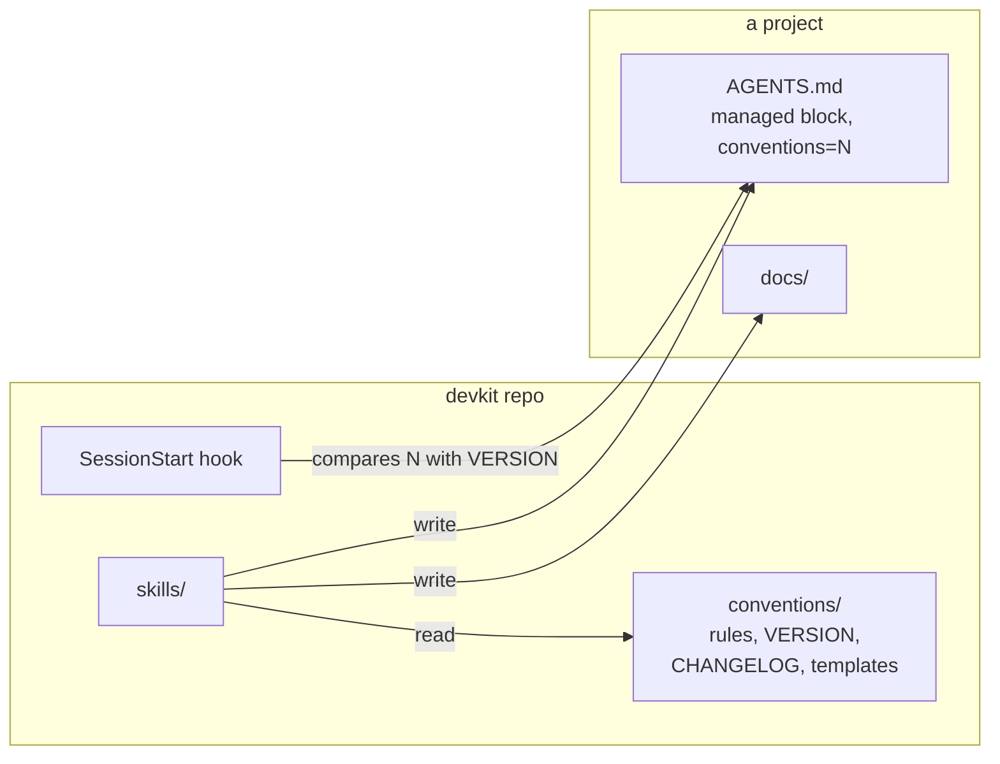
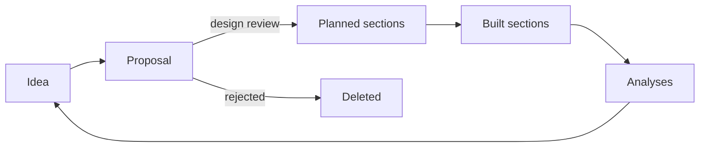

# devkit: Design

1. [Overview](#1-overview)
2. [Goals and non-goals](#2-goals-and-non-goals)
3. [The document set](#3-the-document-set)
4. [Document lifecycles](#4-document-lifecycles)
5. [Plugin structure](#5-plugin-structure)
6. [Starting a project](#6-starting-a-project)
7. [Versioning and upgrades](#7-versioning-and-upgrades)
8. [Changing the conventions](#8-changing-the-conventions)
9. [Testing](#9-testing)
10. [Alternatives considered](#10-alternatives-considered)
11. [Open questions](#11-open-questions)
12. [The development workflow](#12-the-development-workflow)
13. [The doc linter](#13-the-doc-linter)
14. [Distribution](#14-distribution)
15. [The product lifecycle](#15-the-product-lifecycle)
16. [Roles and team size](#16-roles-and-team-size)
17. [Agent context](#17-agent-context)
18. [Products across repos](#18-products-across-repos)
19. [Typed commits](#19-typed-commits)
20. [Restructuring docs](#20-restructuring-docs)

## 1. Overview

devkit is a Claude Code plugin kept in its own public git repo, which is also its marketplace. Users install it from GitHub and get updates when its version changes. The maintainer, and anyone working on a fork, installs it from a checkout instead, so the plugin loads in place and an edit reaches the next session in every project with no reinstall (D14).

It has three parts:

- **Conventions**: one rules file, a version number, a changelog with a migration per version, and templates. They are the source of truth.
- **Skills**: one per task, from starting a project to closing a milestone. Each reads the conventions and templates when it runs rather than repeating them, so the rules exist in one place.
- **A SessionStart hook**: compares the version a project records with the current one and tells the agent when the project is behind.



*The skills read the conventions when they run and write the project's docs. The hook compares the version a project records with the current one.*

## 2. Goals and non-goals

### 2.1 Goals

- Start a project, with a draft PRD, from one request (R1).
- One template and rule set per doc type (R2).
- Conventions that reach agents without the plugin (R3).
- One place to change the conventions, and a safe path for existing projects to follow (R4, R5).
- No effect on projects that haven't adopted devkit (R6).
- The same steps for everyday engineering work in every project (R7).
- Drift from the conventions that can be found, mechanically where possible (R8).
- Every stage of product development, from idea to outcome, kept in the repo for every role, at any team size (R10, R11).
- A repo that gives an agent all the context it needs, and feedback from people who don't use git (R12, R13).
- Only skills that work with lifecycle docs (R14).
- Commit history that says what kind of change each commit is (R15).
- Docs that change with the code, and IDs that trace each change to its decision (R16, R17).

### 2.2 Non-goals

- Scaffolding application code.
- Automatic upgrades. Upgrades change a project's files, so the user always starts them.

## 3. The document set

The conventions in [CONVENTIONS.md](../plugin/conventions/CONVENTIONS.md) codify what the existing projects already converged on, and settle the points where they differed.

| Doc | Taken from | Settles |
| --- | --- | --- |
| `docs/prd.md` | fisc, mycraft and inbox PRDs | Numbered requirements, so the design and plan can cite them |
| `docs/design.md` | fisc, omnix, anneal and kerfu designs, and the design-doc skill | Split into one file per chapter in `docs/design/` past about 600 lines, as any long doc is, because agents pay for length and can load only the chapter they need |
| `docs/plan.md` | omnix's task IDs, grafos's shrinking plan | One plan file, holding the remaining work and the backlog, in place of `todo.md` and `ideas.md` |
| `docs/proposals/` | anneal, kerfu, grafos | Temporary, deleted once decided |
| `docs/analyses/` | anneal's spike results | Kept as evidence |
| `docs/user/` | mycraft and grafos | Indexed by a README table, organized by task |
| `docs/ux.md` | New | The designer's doc: flows, screens and interaction rules, cited by U IDs (D16) |
| `docs/plan/` | New | One file per milestone, so parallel work doesn't collide in one plan file (D16.3) |
| `docs/ops/` | New | Runbooks for projects that run as a service. Optional. |

Analyses hold every kind of evidence: spikes, benchmarks, user research, incident reviews and outcome reviews.

Four kinds of stable ID tie the docs and code together: R for requirements, U for UX sections, D for design sections and M for plan milestones and tasks. mycraft's D numbers and omnix's task IDs showed that agents use them well. They make a citation like `D8.3` in a code comment mean one thing for the life of the project, so an ID never changes meaning, even when its doc is restructured (D20).

The rules for writing style come from the user's global preferences and the ideas repo: plain sentences, no em dashes, no time estimates, images as separate files.
Text users read has stricter rules from the user's own editing: one point per sentence, no colons and no lists of three.

## 4. Document lifecycles

The key decision is which docs are permanent. Agents treat everything in the repo as current, so a finished proposal or a stale plan item misleads them. Docs therefore hold only the current state of the process, and git holds the history. The one exception is checking off plan tasks while a milestone is in progress. The current state includes what is decided but not built, marked as planned (D15.2).

- **Proposals** are arguments, deleted once decided. A design review writes the decided change into its final docs and deletes the proposal in the same change (D15.3). Git keeps the original. This is grafos's rule. It replaces the per-project choices: anneal kept proposals, and omnix banned them.
- **Planned sections** carry a marker naming the milestone that builds them, and lose it when that milestone finishes.
- **The plan** shrinks. A finished milestone is removed. The plan stays short enough to read in full each session.
- **Analyses** are kept and never rewritten. They are the evidence the design cites.
- **Done means documented**, from mycraft: a milestone isn't done until the user docs, UX and design match what was built (R16).

## 5. Plugin structure

```
devkit/
  .claude-plugin/marketplace.json   the repo as a marketplace
  .github/workflows/check.yml       CI running just check
  plugin/
    .claude-plugin/plugin.json
    conventions/
      CONVENTIONS.md                the rules
      VERSION                       an integer
      CHANGELOG.md                  what changed per version, and its migration
      templates/                    AGENTS.md, agents-block.md, justfile, lint-docs.sh, docs/...
    skills/<name>/SKILL.md          invoked as devkit:<name>
    hooks/hooks.json
    scripts/session-start.sh
  tests/
```

The skills are:

| Skill | Purpose |
| --- | --- |
| `new-project` | Section 6 |
| `prd`, `design`, `plan`, `proposal`, `analysis`, `user-docs` | Write and update one doc type each |
| `ux`, `release` | Write the UX doc, and tag a release (D16, D15.4) |
| `design-review` | Write a decided change into the docs as planned sections, or reject a proposal (D15.3) |
| `finish-milestone` | Check docs match a milestone, then remove it from the plan |
| `implement`, `fix-bug` | Section 12 |
| `upgrade` | Section 7.3 |
| `audit` | Section 12.3 |
| `restructure` | Merge, split, move or reorder sections, keeping every ID (D20) |

Each skill names its template and the conventions by `${CLAUDE_PLUGIN_ROOT}` paths and reads them when it runs. A skill's description says when to use it, so plain requests such as "write a proposal for switching to SQLite" find the right one. Every description except those of `new-project` and `upgrade` starts with "In a project that uses devkit", so the skills aren't offered in projects that don't (R6).

The doc skills check for the managed block in `AGENTS.md` first. In a project without it, they say the project doesn't use devkit and ask before applying its structure (R6).

### 5.1 What the plugin ships

Every skill the plugin ships produces, updates or depends on a lifecycle doc (R14). Each one costs context in every session of every project and a chance of triggering on an unrelated request, so a skill that doesn't touch the docs doesn't ship. There is no skill for refactoring code, whose doc rules fit in the conventions (D12.4), though `restructure` reorganizes the lifecycle docs themselves (D20), and none for a view across projects, since the hook tells each project when it is behind (D7.3). `evolve` changes devkit itself, so it lives in devkit's repo (D8.1). Only `new-project` and `upgrade` lack the "In a project that uses devkit" opening, since both run before a project uses devkit.

## 6. Starting a project

`devkit:new-project` turns one request into a committed repo:

1. Work out the name, pitch, location, stack and any source idea from the request, and ask once for what's missing. The location defaults to `<projects>/<slug>`, where the projects directory is `DEVKIT_PROJECTS_DIR`, or else the parent of the current directory when that is a git repo. If neither gives one, it asks.
2. Create the repo with `AGENTS.md`, `CLAUDE.md` containing `@AGENTS.md`, `README.md`, a justfile, `docs/README.md` and `docs/prd.md`. If the stack is known, add a first component with its own justfile as a module.
3. If the user points to an idea doc, start from it, and follow any graduation steps its repo's `AGENTS.md` gives, so the two flows join.
4. Draft the PRD with `devkit:prd`, leaving unknowns as open questions.
5. Commit, and tell the user what the PRD needs from them.

It deliberately stops at the PRD. The PRD is the one doc where the user's intent can't be inferred, so it is the natural checkpoint before the design.

## 7. Versioning and upgrades

### 7.1 Versions

The conventions have an integer version in `plugin/conventions/VERSION`, separate from the plugin's version. It changes only when what a project should look like changes, not when a skill's wording improves. Each version has a section in `CHANGELOG.md` headed `## v<N>: <summary>`, with what changed and a migration: steps for an agent to bring a project from N-1 to N.

Migrations are written for an agent, not a script. Most real changes, such as merging a todo file into the plan or folding a done proposal into the design, need judgment that a script can't make.

### 7.2 Where a project records its version

The project's `AGENTS.md` contains a block managed by devkit:

```markdown
<!-- devkit:begin conventions=1 -->
## Docs
...summary of the conventions...
<!-- devkit:end -->
```

The marker records the version, and the block gives the conventions to any agent that reads `AGENTS.md`, plugin or not (R3). Only an upgrade replaces the block, and everything outside it belongs to the project. One marker in a file the project already has avoids a separate stamp file.

### 7.3 Being told, and upgrading

At session start, the hook reads the marker and `VERSION`. If the project is behind, it prints the changelog summaries since the project's version and asks the agent to offer `devkit:upgrade`. If the project is current or has no marker, it prints nothing, so it costs nothing in projects that don't use devkit.

`devkit:upgrade` collects the migrations, shows the user the concrete changes and questions, and applies them only after approval. Then it replaces the managed block and commits. A migration that only replaces the block may proceed without asking.

### 7.4 Adopting devkit in an existing project

An existing project is at v0. The v1 migration is the adoption: inventory the docs, map them onto the document set, list where the project differs on purpose, and propose all of it before changing anything. Project rules that conflict with the conventions, such as omnix's ban on proposals, are the user's call: they stay as project rules outside the block or give way.

## 8. Changing the conventions

Conventions will change as projects find better ways. The `evolve` skill makes the change in a session in the devkit repo (D8.1):

1. Decide whether it is a convention change, which needs a version and a migration, or a skill change, which doesn't.
2. Edit the rules, templates and skills together so they agree.
3. Bump `VERSION` and write the changelog section and migration, and bump the plugin version (D14.1).
4. Run `just check` and commit.

The change reaches new projects at once. Existing projects learn of it at their next session through the hook, and upgrade when the user chooses. A change usually comes up in the middle of project work: "from now on, plans should also have X". The skill separates what is general from what belongs to that project alone.

### 8.1 Where evolve lives

`evolve` is a skill in devkit's repo, in `.claude/skills/evolve/`, not in the plugin (D5.1). It is offered only in a session in a devkit checkout or a fork, which is the only place it can edit. A fork carries it because it is part of the repo. A change that comes up in the middle of other project work is made by opening a session in the checkout. A rule that only matters to one project goes in that project's `AGENTS.md`, outside the managed block, which needs no skill.

## 9. Testing

`just check` runs:

- shellcheck on the scripts,
- `claude plugin validate` on the marketplace and the plugin,
- the hook's tests, which run it against a fake plugin and fake projects that are current, behind, ahead, unmarked or without `AGENTS.md`,
- the doc linter on devkit's own docs, and its tests against fake projects,
- the commit check on unpushed commits, and its tests against a temporary repo,
- consistency checks: `VERSION` matches the newest changelog entry and the major number of the plugin version, every skill's name matches its directory and appears in the user docs, every path and skill a skill names exists, the managed block has its markers, and no em dashes.

CI runs `just check` on every push and pull request, and the commit check on every commit since the check was added. `mise.toml` pins `just` and `shellcheck`, and CI installs a pinned `claude` CLI, which validates manifests without credentials.

The skills are prompts, so the real test is using them. Section 11 lists the trial runs still to do.

## 10. Alternatives considered

### 10.1 A Copier or cookiecutter template

Copier can render a project and later merge template updates into it. It handles files, but the projects span Rust, Swift, TypeScript and Python, so the shared part is conventions and judgment rather than files. Its updates are three-way merges of text, which can't fold a todo file into a plan. Skills can, and a plugin updates in one place.

### 10.2 Architecture decision records

A `docs/decisions/` folder with one file per decision. None of the projects used them. Each design section already records the decision it holds and why, and Alternatives considered records what was rejected, without another folder for agents to keep in step.

### 10.3 Conventions in the global CLAUDE.md

Putting the rules in `~/.claude/CLAUDE.md` would load them in every session, including unrelated ones, at a context cost. It has no version, so nothing can tell a project it's behind, and other agents don't read it.

### 10.4 Copying the conventions into each project

A full copy of the rules in each repo is what agents without the plugin would need. But copies drift, and that is the problem with the duplicated `CLAUDE.md` files today. The managed block is a short summary that an upgrade replaces wholesale, which keeps drift visible and fixable.

### 10.5 Automatic upgrades

The hook could run the upgrade itself. But migrations move and rewrite docs, possibly in the middle of other work, so the user starts them.

### 10.6 A stamp file for the version

A file such as `.devkit` could hold the version. The managed block already has to exist for R3, so its marker carries the version with no extra file.

### 10.7 A local marketplace only

Everyone could clone the repo and run `just install`, so the plugin always loads in place. But that needs `just` and a checkout kept up to date by hand, and users would get every unreleased commit. Installing from GitHub gives users releases, and the checkout route stays for the maintainer and forks.

### 10.8 A decision log and Done list in the plan

anneal kept a dated decision table, and a plan could keep finished milestones as one-line entries. Both are history, which git already keeps with the commit that made each change. In the docs they grow without bound and cost context every session, while the decision itself already lives in the design section it governs.

### 10.9 markdownlint and a link checker

Off-the-shelf linters would check links and Markdown style. They add a tool dependency to every project, and none know devkit's rules, such as citations or the doc index. A small script checks exactly the conventions.

### 10.10 Fold proposals in at acceptance

The old rule. An accepted proposal's design was edited into the docs at once. It is simple, but main mixed built and unbuilt work with no marker, and the docs were reviewed as a proposal's prose, not as the text that landed.

### 10.11 Accepted proposals as in-flight specs

An accepted proposal could stay on main until its work ships, then fold into the docs. But the review is still of prose, the fold rewrites the design after approval with no real review, and one feature takes proposal, code and fold changes. Planned sections give the same visibility with one review of the final text.

### 10.12 A feature branch per feature

Exploration, doc edits and code could live on one branch that merges once, keeping main to what is built. But in-flight work is then invisible from main, long branches drift, and dependent features need stacked branches. Treating main as the state of the process removes the reason to keep planned work off it.

### 10.13 Separate solo and team profiles

A light set of conventions and a full one would each fit better. But a solo project that gains a contributor would need a migration between them, and the two would drift apart.

### 10.14 Syncing with a wiki

Edits made in a wiki could flow back into the repo. But that makes two places a doc can change, so neither is the source of truth, and merging prose edits needs judgment a sync can't make. A one-way mirror people can comment on is under Later in the plan.

### 10.15 One docs folder per role

`docs/product/`, `docs/design/` and `docs/engineering/` would mirror how teams organize. But it moves every existing doc, clashes with the chapter folder a split design uses, and a solo developer would hop between folders for one change.

### 10.16 UX inside the PRD or the design

It avoids a new doc. But the PRD says what and why, not how screens behave, and the design is already the longest doc. The IDs also wouldn't say which kind of decision is cited.

### 10.17 A home repo per cross-repo change

A change spanning repos could live in whichever repo owns most of it. But nothing would hold product-level truth, each repo would review its part separately, and an agent in one component has no fixed place to find the rest.

### 10.18 IDs that can't collide

Names or random suffixes such as `D-sync` would remove numbering races. But numbers show a section's level and are short to cite, and with branches kept current a race costs one rebase.

### 10.19 Open pull requests as agent context

Skills could read open pull requests to spot overlapping work early. But unreviewed work isn't part of the state of the process, it would need the Git host's CLI and credentials, and overlaps surface anyway when the later change rebases (D16.3).

### 10.20 Fold release into finish-milestone

The doc checks in `release` overlap with `finish-milestone`, and the tag rule is in CONVENTIONS section 9. But a release can ship part of a milestone or several, and outcome reviews would lose the event that prompts them, which is what feeds results back to the PRD (D15.4).

### 10.21 Evolve in the plugin

Shipping `evolve` keeps "from now on" requests working in any project. But every user carries a skill that edits only in a checkout of devkit or a fork, and most never use one.

### 10.22 A short refactor skill

A skill holding only the refactor doc rules would trigger on every "clean up" request, for rules the managed block carries in one line.

### 10.23 The company as a project

A company monorepo could hold many products and shared systems as scopes under company objectives, with one priority order across teams and a trace from objective to code. devkit serves a single project and its product development instead. Scopes, objectives and cross-team priority would add rules that every solo project's agents read and skip, and there was no company repo to trial them on. Related repos (D18) still covers one product across several repos.

### 10.24 Issues in the repo

Bugs, requests and the backlog could be files in `docs/issues/` with `I` IDs and a triage step, replacing an issue tracker. devkit covers the docs that shape the product, not the queue of incoming work. Unscheduled ideas stay under Later in the plan, and a bug goes straight to `fix-bug`.

### 10.25 Conventional Commits

A `fix(sync):` prefix is the most widely tooled way to type commits, and shows in `git log --oneline`. But the prefix spends subject characters, its types describe engineering work rather than who cares, and notes generated from it are subjects written for engineers. Its tools also compute versions, which `release` leaves to judgment (D15.4).

### 10.26 One Changelog trailer only

GitLab types only the commits users see, and uses the subject as the note. Untyped commits can't then be told apart, so operators and reviewers get no filter, and a forgotten trailer looks like an internal change.

### 10.27 Pull request labels or a release-note block

GitHub's generated notes and Kubernetes' release-note block work well for hosted teams. They live on the Git host, so an agent needs its CLI to read them (D17), and a solo project committing to main has no pull requests.

### 10.28 News fragments

towncrier or Changesets keep one file per change with a note in user words. They add a folder that fills and empties each release, a tool per ecosystem, and a file that repeats the commit. A `Changelog:` trailer carries the same sentence in the commit itself.

### 10.29 Renumbering with citations rewritten

A restructure could renumber sections in order and rewrite every citation to match. Code and docs can be rewritten, but commit messages and other repos can't, so `git log --grep` and qualified IDs would point at the wrong section.

### 10.30 A list of retired IDs

Old IDs could live in one table per doc. An alias next to the text it names needs no lookup, moves with its section, and is read by anyone reading the section.

## 11. Open questions

- **The first trial.** The skills haven't been used on a real new project yet. The first real use will show where they ask too much or too little.
- **Existing projects.** Adopting devkit in a project that already has docs is the hardest migration and hasn't been tried. The first adoptions will show what it needs.
- **Product repo size.** A product split over two repos may not need a third. A component repo could act as the product repo.
- **Attribution.** Docs never name people, but feedback comes from people. Naming them in commit bodies may be enough.
- **Outcome timing.** Some success criteria take weeks of use to measure. The plan could carry a task for each outcome review so it isn't forgotten.
- **Fork versions.** A fork that evolves bumps `VERSION` on its own, so its v2 and upstream's v2 mean different things and merging upstream conflicts. For now forks are expected to stay forks.

## 12. The development workflow

The conventions cover how code is written and shipped as well as how docs are kept, so an agent works the same way in every project (R7). The rules are about process, not technology: no rule names a language, library or domain. They live in CONVENTIONS.md sections 9, 11, 12, 13 and 16, and the managed block carries a line for each.

### 12.1 Skills for the core loop

- `implement` takes a plan task from reading its cited sections to a commit that ticks it. It starts and ends with `just check` passing, and stops to ask where the design is silent, so design decisions don't get made inside code.
- `fix-bug` reproduces first, writes a failing test, then decides whether the fault is in the code, the design or the PRD. A bug the design caused is fixed in the design too, so the next agent doesn't repeat it.

### 12.2 Shared rules

- **Commits** are one change with its tests and docs, with a plain subject citing IDs and trailers naming its kind of change (R16, D19). Commits are the history the docs leave out, so they carry the why.
- **Releases** are annotated tags whose messages list user-visible changes. A CHANGELOG file would be history in the docs, which section 4 rules out.
- **Tests** run offline from `just test`, and a bug fix starts with a failing test.
- **Dependencies** that shape the design are design decisions, recorded with their alternatives.
- **Secrets** stay out of git, with local settings in a gitignored `.env` documented by `.env.example`.
- **Refactors** keep the docs true without a skill of their own (D12.4).
- **Recipes** gain `fmt`, `run` and `setup` where they apply, so the same command does the same job everywhere.

### 12.3 Finding drift

Migrations only cover what changed between versions. A project can also drift on its own, such as a hand-edited managed block or a `todo.md` that crept back in. `audit` compares a project with the current rules, running the doc linter for what is mechanical and reading the rest (R8).

### 12.4 Refactors

A refactor keeps behavior, so its only effect on the docs is keeping them true. CONVENTIONS section 16 says ID citations move with their code, D sections describing the old structure are updated, a refactor that changes a D section or moves code between components starts as a proposal, and a change to user docs means behavior changed. The managed block carries one line for it, so agents without the plugin follow it (R3). How to judge an abstraction is coding craft, not a doc rule, so devkit has no refactor skill (D5.1).

## 13. The doc linter

`lint-docs.sh` is a plain bash script, compatible with the bash 3.2 that ships with macOS, with no other dependency. It checks the docs for em dashes, docs past 600 lines, broken relative links, docs missing from their index, R, U and D citations to sections that don't exist or that cite an alias (R17), IDs defined twice, IDs defined at the base commit that are now gone (D20.2), planned markers naming a milestone the plan doesn't have, and planned markers in user docs. IDs in backticks are examples and aren't checked, and neither are qualified IDs such as `api:D4.2`, which name another repo (D18). Analyses aren't checked for citations, since they are never rewritten. M citations aren't checked, since finished milestones leave the plan.

Each project gets a copy at `.devkit/lint-docs.sh`, run by its root `lint` recipe. A project's justfile can't reach the plugin's install path, and CI runs without the plugin, so the script must live in the repo. Like the managed block, the copy belongs to devkit and is replaced on every upgrade, so a change to it is a convention change with a version bump.

The script checks only what is unambiguous. Citations in code are left to `audit`, since identifiers such as `R2` mean other things in code.

## 14. Distribution

devkit is a public GitHub repo that is its own marketplace (R9).

### 14.1 Versions

The plugin version in `plugin.json` is semver whose major number is the conventions `VERSION`. A convention change bumps the major, a skill change the minor, and a fix the patch. Claude Code updates a cached install only when this version changes, so every change that should reach users moves it. The consistency test fails when the major and `VERSION` disagree. Each release is an annotated `v<version>` tag.

### 14.2 Two ways to install

- **From GitHub**: `/plugin marketplace add jthacker/devkit`, then `/plugin install devkit@devkit`. Claude Code caches the plugin and updates it when the version changes. This is the route for users.
- **From a checkout**: `just install`. The plugin loads in place, so an edit reaches the next session. This is the route for the maintainer and for forks.

The README gives the GitHub route. Working from a checkout is in `AGENTS.md` and the user docs on forking.

### 14.3 Forks

Someone who wants different conventions forks devkit, clones the fork and runs `just install` from it. A session in the fork offers `evolve`, which edits it (D8.1). Changes worth sharing go upstream as pull requests. Forks merging upstream changes is not supported, as section 11 notes.

### 14.4 Alternatives

- **A plugin version separate from the conventions.** A convention change could then ship without a version bump, and cached installs would miss it. Tying the major to `VERSION` makes that mistake fail a test.

## 15. The product lifecycle

devkit treats product development as version control (R10). Main holds the reviewed state of the whole process, not only of the code: what is built, what is decided but not built, and what is being considered. Branches hold unreviewed work, and a pull request, or the user's approval on a solo project, is the filter. Git history holds how each part got there.

### 15.1 Stages

| Stage | On main as | Skills |
| --- | --- | --- |
| Idea | A line under the plan's Later | `plan` |
| Under consideration | A proposal in `docs/proposals/` | `proposal` |
| Decided, not built | Sections in the PRD, UX and design in final form, marked planned | `design-review` |
| Being built | The same sections, cited by open plan tasks | `implement`, `fix-bug` |
| Built | The same sections without the marker, and `docs/user/` updated | `finish-milestone`, `user-docs`, `release` |
| Operated | Runbooks in `docs/ops/`, incident reviews in `docs/analyses/` | `analysis` |
| Learned | Research and outcome reviews in `docs/analyses/` | `analysis` |



*Each stage leaves a reviewed result on main, and what is learned starts the next change.*

### 15.2 Planned sections

A decided change is written straight into its final home. A section not built yet has a marker naming the milestone that builds it, as the first line under its heading:

```markdown
## 15. Sync engine

**Planned:** M5

How sync works, written as it will read once built.
```

A PRD requirement carries it after its title. A partly built section keeps its current text and adds the change as a planned subsection.

The marker is state, so tooling keeps it honest. The linter fails when a marker names a milestone the plan doesn't have, so removing a milestone can't leave planned sections behind. `finish-milestone` removes the markers for its milestone and changes nothing else in the section. `implement` treats a planned section as a spec to build. Dropping planned work removes its sections, or moves them to Alternatives considered, in a reviewed change. `docs/user/` holds only built behavior.

### 15.3 Design review

A proposal is an argument: the problem, the options and the case for one. It is optional, since a change that needs no argument skips it.

The decision is one reviewed change, made by `design-review`. It writes the PRD, UX and design into their final wording with planned markers, takes the next free R, U and D numbers, adds the plan tasks, moves rejected options into Alternatives considered, and deletes the proposal. Reviewers see the docs as they will read, as a diff against main, so approving and merging it is the decision. Nothing rewrites that text after approval except removing the marker when it ships.

Exploration before it can take any number of commits on a branch, and none of it reaches main. A proposal may be merged on its own when it is worth wider discussion. Building takes as many changes as the work needs, and a small feature can put the design review and the code in one change.

### 15.4 The ends of the lifecycle

A release is an annotated tag listing user-visible changes. `release` builds them from the commits' `Changelog:` trailers since the last tag (D19.3), checks that `docs/user/` covers them, and writes the tag. An incident review is an analysis of what happened, the cause and what changes. Each PRD success criterion says how it is measured, and an outcome review checks the criteria after a release. Its recommendations become ideas or proposals, which closes the loop.

## 16. Roles and team size

### 16.1 A home for each role

| Role | Doc | IDs |
| --- | --- | --- |
| Product manager | `docs/prd.md` | R |
| Designer | `docs/ux.md` | U |
| Engineer | `docs/design.md`, `docs/plan.md` | D, M |
| Researcher | `docs/analyses/` | None |
| Writer | `docs/user/` | None |
| Operator | `docs/ops/` | None |

`ux.md` describes how people experience the product: flows as Mermaid diagrams, screens as PNG or SVG images in `docs/ux/`, interaction rules, and the design system where there is one. Reviewers compare screens in the Git host's image diff. Each section's text says what its screens show, so an agent doesn't depend on the images. A section whose source lives in a design tool links to it, and the committed image is the decided version. A project starts `ux.md` when it first has an interface beyond commands. A threat model is an optional Security section in the design. `design.md` keeps its name, since its D IDs are cited throughout existing projects.

### 16.2 Solo and team

The layout and lifecycle are the same at any size (R11). What scales is how much is written and who reviews.

| | Solo | Team |
| --- | --- | --- |
| Unreviewed work | The working tree, or a branch | A branch |
| Review | The user approves the agent's change | A pull request |
| Design review | One commit on main | One pull request |
| Proposals | Rare, for changes worth arguing | For changes others must agree on |
| Roles | One person, prompted per role | CODEOWNERS maps doc paths to people |

A project in team mode says so in `AGENTS.md`, outside the managed block, and the skills read it. Solo, `design-review` asks one question per role the change touches, so one person still covers each view. People who don't use git review and comment on pull requests in the browser, or pass feedback through an agent. A commit that resolves feedback says in its body what was raised and how it was resolved, so the outcome is in the repo even when the discussion isn't (R13).

### 16.3 Many people at once

Every design review touches shared counters and files. Team mode requires branches to be current with main before merging, or a merge queue, so the linter checks the merged result and a duplicate ID fails. The later change renumbers on rebase, which is safe since nothing on main cites its numbers yet. The plan keeps one file per milestone in `docs/plan/`, and team projects split the PRD and design by chapter from the start, so most text conflicts disappear.

Two design reviews that change the same section are a design conflict. It surfaces when the later one rebases onto a main holding the earlier one's planned sections, and `design-review` re-checks its changes against what is new on main after every rebase. Duplicate effort is for people to coordinate. Who works on a task lives in its pull request or a tracker, never in the plan.

## 17. Agent context

Agents succeed or fail on context (R12). The test for every rule here is whether an agent at any stage can find what it needs, trust that it is current, and load only that.

- **Finding it.** `AGENTS.md` points to `docs/README.md`, which indexes every doc with a line on what it holds. IDs lead to the exact section, and chapter and milestone files keep each load small.
- **Trusting it.** A built section matches the code because a milestone isn't done until it does. A planned section says it isn't built.
- **History.** Commits cite IDs, so `git log --grep` on an ID returns every change to a section with its reasons (R17). The skills read it before changing a section.
- **By stage.** Each skill names what it reads: a build reads the task, the planned sections it cites, the built sections they depend on, and the code. A bug fix reads the user docs and design for the behavior, incident reviews and the cited sections' history.
- **Beyond the checkout.** Unreviewed work on other branches isn't context, and no skill depends on the Git host's CLI. Related repos are declared in `AGENTS.md` and cloned to read (D18). Discussion elsewhere is out of reach by design, and its outcome lands in commits.

## 18. Products across repos

A monorepo is the first choice. When components must live apart, a product repo holds the PRD, `ux.md`, the design of what crosses repos such as contracts between components, the cross-repo proposals and the outcome reviews. Each component repo keeps a design of its own internals and its own plan.

- A change that crosses repos has one design review, in the product repo. Component repos follow through implementation, with planned sections where their internals change.
- Each repo's `AGENTS.md` has a Related repos section, outside the managed block, naming each related repo by a short name with its role and clone location.
- Citations across repos are qualified, as in `api:D4.2`. The linter skips them, since it runs without the network, and `audit` checks them with the related repos cloned.
- A product milestone lists tasks per repo, as in `M7.2 (api)`. `finish-milestone` in the product repo removes planned markers only once the component changes it cites have merged.

## 19. Typed commits

IDs say what part of the product a commit touches, not what kind of change it is. Typed commits add the kind, so readers filter history and `release` stops judging each commit by its subject (R15).

### 19.1 The trailers

Every commit ends with a `Change:` trailer. A commit users notice also has a `Changelog:` trailer, one sentence written for users under section 4.1 of the conventions. The subject stays the plain sentence citing IDs.

```text
Retry failed syncs so edits survive a dropped connection, D8.3

The client gave up after one failed attempt, so offline edits were
dropped when the connection returned mid-sync.

Change: fixed
Changelog: Edits made offline are no longer lost if the connection drops.
```

| Value | Meaning | Changelog |
| --- | --- | --- |
| `added` | New behavior users see | Required |
| `changed` | Different behavior users see | Required |
| `deprecated` | Behavior that will be removed | Required |
| `removed` | Behavior users relied on is gone | Required |
| `fixed` | A bug users could hit is fixed | Required |
| `security` | A vulnerability is fixed | Required |
| `ops` | Config, deployment or runtime changes operators need | Optional, for operators |
| `docs` | Docs only, including design reviews and proposals | None |
| `internal` | Refactors, tests, build, tooling and dependencies | None |

The first six are Keep a Changelog's categories and GitLab's trailer values, so notes group the way most changelogs do and tools such as git-cliff can read them. The last three serve the other readers in D16.1. A commit has one `Change:` value. A change that is two kinds, such as a fix that also deprecates something, is two commits.

Trailers keep the data in the repo, where git reads it with no host access (D17):

```sh
git log --grep '^Change: fixed' v1.2.0..
git log --format='%(trailers:key=Changelog,valueonly)' v1.2.0..
```

They don't show in `--oneline`, and each commit gains two lines. Agents write nearly every commit, so the lines cost little. On a squash merge in team mode, the squash message must keep the trailers, and the commit check catches it when it doesn't.

### 19.2 The commit check

`.devkit/check-commits.sh` fails on a commit with no `Change:`, more than one, an unknown value, a user-facing value with no `Changelog:`, or a `Changelog:` on `docs` or `internal`. It takes a git range, and defaults to the commits not yet on the upstream branch, so `just lint` checks unpushed work and CI can pass the range it builds. Merge commits are skipped. So are commits made before the script was added, so a project's history from before it adopted devkit needs no rewriting. Like the linter, it is plain bash with only git, and devkit replaces it on upgrade (D13).

### 19.3 Release notes

`release` builds the tag message from the `Changelog:` trailers since the last tag, grouped under the `Change:` values in table order, with `ops` notes in a section for operators. It then checks the notes against `docs/user/` as before. For commits from before a project added the commit check, it reads the log and judges, as it did.

## 20. Restructuring docs

A PRD, UX doc or design outgrows its first outline. Chapters need merging, splitting, reordering or adding, and a subsection grows into a chapter. With IDs taken from heading numbers, that would change what a citation means. So a number is a label, not a position, and an ID survives every restructure (CONVENTIONS section 18).

### 20.1 Aliases

The section that takes over an ID's text lists it on an `**Also:**` line under its heading. An alias covers its subsections, so a promoted section needs one alias, not one per child. The alias sits next to the text it names, so a reader of the section sees its old IDs and greps history for each (R17). Docs cite current IDs, which keeps them readable. Code and commits keep their citations, which still resolve. `restructure` does the work and maps old IDs to new in the commit body (D5).

### 20.2 What the linter checks

`lint-docs.sh` reads aliases as definitions, so the duplicate check stops an alias from being reused. A doc citing an alias fails with the current ID to use. Every ID defined at the base commit, live or alias, must still be live or covered by an alias. The base defaults to the upstream branch, so the check covers unpushed commits and uncommitted edits, and CI on a pull request passes the target branch. It reads the base docs with `git archive`, so it needs nothing beyond git (D13). It doesn't catch two sections swapping numbers, which keeps both IDs defined, so `restructure` maps every move before making it.

