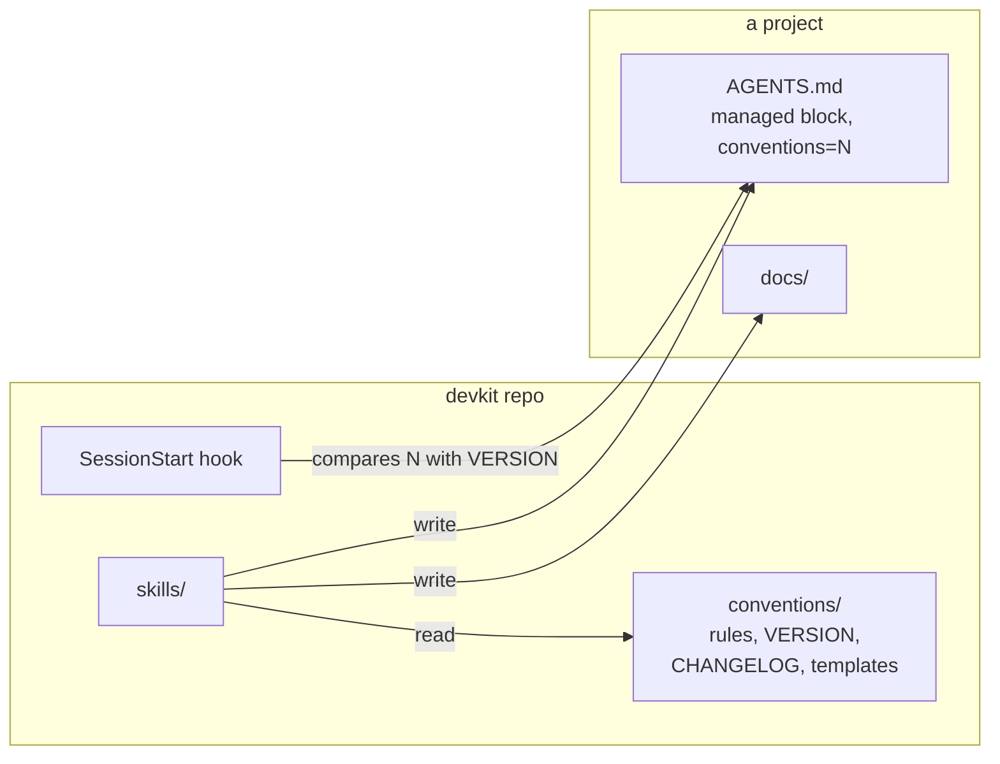
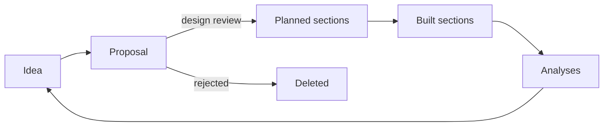

# devkit: Design

1. [Overview](#design-1r17)
2. [Goals and non-goals](#design-x9g7)
3. [The document set](#design-80rq)
4. [Document lifecycles](#design-01c5)
5. [Plugin structure](#design-e8ng)
6. [Starting a project](#design-076f)
7. [Versioning and upgrades](#design-b15a)
8. [Changing the conventions](#design-7z28)
9. [Testing](#design-axx8)
10. [Alternatives considered](#design-69gn)
11. [Open questions](#design-b2ea)
12. [The development workflow](#design-xn06)
13. [The doc linter](#design-0sxx)
14. [Distribution](#design-fx31)
15. [The product lifecycle](#design-e4be)
16. [Roles and team size](#design-460p)
17. [Agent context](#design-04hv)
18. [Products across repos](#design-gh6m)
19. [Typed commits](#design-6wkj)
20. [Section IDs](#design-bdk3)

## 1. Overview <a id="design-1r17"></a><a id="D1"></a>

devkit is a Claude Code plugin kept in its own public git repo, which is also its marketplace. Users install it from GitHub and get updates when its version changes. The maintainer, and anyone working on a fork, installs it from a checkout instead, so the plugin loads in place and an edit reaches the next session in every project with no reinstall ([Distribution](#design-fx31)).

It has three parts:

- **Conventions**: one rules file, a version number, a changelog with a migration per version, and templates. They are the source of truth.
- **Skills**: one per task, from starting a project to closing a milestone. Each reads the conventions and templates when it runs rather than repeating them, so the rules exist in one place.
- **A SessionStart hook**: compares the version a project records with the current one and tells the agent when the project is behind.



*The skills read the conventions when they run and write the project's docs. The hook compares the version a project records with the current one.*

## 2. Goals and non-goals <a id="design-x9g7"></a><a id="D2"></a>

### 2.1 Goals <a id="design-f4tn"></a><a id="D2.1"></a>

- Start a project, with a draft PRD, from one request ([PRD: Start a project in one request](prd.md#prd-gfx8)).
- One template and rule set per doc type ([PRD: One format](prd.md#prd-830w)).
- Conventions that reach agents without the plugin ([PRD: Agents know the rules without the plugin](prd.md#prd-68zv)).
- One place to change the conventions, and a safe path for existing projects to follow ([PRD: Conventions evolve in one place](prd.md#prd-by6e), [PRD: Existing projects catch up on request](prd.md#prd-a19r)).
- No effect on projects that haven't adopted devkit ([PRD: Existing projects are untouched until adopted](prd.md#prd-4svd)).
- The same steps for everyday engineering work in every project ([PRD: One way of working](prd.md#prd-27en)).
- Drift from the conventions that can be found, mechanically where possible ([PRD: Drift is visible](prd.md#prd-5j7p)).
- Every stage of product development, from idea to outcome, kept in the repo for every role, at any team size ([PRD: Lightweight change management in the repo](prd.md#prd-8z7e), [PRD: Any team size](prd.md#prd-77ak)).
- A repo that gives an agent all the context it needs, and feedback from people who don't use git ([PRD: The repo is all an agent needs](prd.md#prd-5h1g), [PRD: Feedback without git](prd.md#prd-kb8q)).
- Only skills that work with lifecycle docs ([PRD: Only the lifecycle](prd.md#prd-a6kk)).
- Commit history that says what kind of change each commit is ([PRD: History by kind of change](prd.md#prd-6v2e)).
- Docs that change with the code, and IDs that trace each change to its decision ([PRD: Docs current with the code](prd.md#prd-2c17), [PRD: Every change traces](prd.md#prd-x3qg)).

### 2.2 Non-goals <a id="design-zw31"></a><a id="D2.2"></a>

- Scaffolding application code.
- Automatic upgrades. Upgrades change a project's files, so the user always starts them.

## 3. The document set <a id="design-80rq"></a><a id="D3"></a>

The conventions in [CONVENTIONS.md](../plugin/conventions/CONVENTIONS.md) codify what the existing projects already converged on, and settle the points where they differed.

| Doc | Taken from | Settles |
| --- | --- | --- |
| `docs/prd.md` | fisc, mycraft and inbox PRDs | Requirements with IDs, so the design and plan can cite them |
| `docs/design.md` | fisc, omnix, anneal and kerfu designs, and the design-doc skill | One file, however long, since agents load one section by its ID ([One file per doc](#design-a05p)) |
| `docs/plan.md` | omnix's task IDs, grafos's shrinking plan | One plan file, holding the remaining work and the backlog, in place of `todo.md` and `ideas.md` |
| `docs/proposals/` | anneal, kerfu, grafos | Temporary, deleted once decided |
| `docs/analyses/` | anneal's spike results | Kept as evidence |
| `docs/user/` | mycraft and grafos | Indexed by a README table, organized by task |
| `docs/ux.md` | New | The designer's doc: flows, screens and interaction rules ([Roles and team size](#design-460p)) |
| `docs/plan/` | New | One file per milestone, so parallel work doesn't collide in one plan file ([Many people at once](#design-5ndn)) |
| `docs/ops/` | New | Runbooks for projects that run as a service. Optional. |

Analyses hold every kind of evidence: spikes, benchmarks, user research, incident reviews and outcome reviews.

Stable IDs tie the docs and code together: one per section of the PRD, UX doc and design, such as `design-7kq3`, and `M2.3` for plan milestones and tasks. mycraft's D numbers and omnix's task IDs showed that agents use them well. An ID makes a citation in a code comment mean one thing for the life of the project, even when its doc is restructured ([Section IDs](#design-bdk3)).

The rules for writing style come from the user's global preferences and the ideas repo: plain sentences, no em dashes, no time estimates, images as separate files.
Text users read has stricter rules from the user's own editing: one point per sentence, no colons and no lists of three.

## 4. Document lifecycles <a id="design-01c5"></a><a id="D4"></a>

The key decision is which docs are permanent. Agents treat everything in the repo as current, so a finished proposal or a stale plan item misleads them. Docs therefore hold only the current state of the process, and git holds the history. The one exception is checking off plan tasks while a milestone is in progress. The current state includes what is decided but not built, marked as planned ([Planned sections](#design-5geq)).

- **Proposals** are arguments, deleted once decided. A design review writes the decided change into its final docs and deletes the proposal in the same change ([Design review](#design-vb0a)). Git keeps the original. This is grafos's rule. It replaces the per-project choices: anneal kept proposals, and omnix banned them.
- **Planned sections** carry a marker naming the milestone that builds them, and lose it when that milestone finishes.
- **The plan** shrinks. A finished milestone is removed. The plan stays short enough to read in full each session.
- **Analyses** are kept and never rewritten. They are the evidence the design cites.
- **Done means documented**, from mycraft: a milestone isn't done until the user docs, UX and design match what was built ([PRD: Docs current with the code](prd.md#prd-2c17)).

## 5. Plugin structure <a id="design-e8ng"></a><a id="D5"></a>

```
devkit/
  .claude-plugin/marketplace.json   the repo as a marketplace
  .github/workflows/check.yml       CI running just check
  plugin/
    .claude-plugin/plugin.json
    conventions/
      CONVENTIONS.md                the rules
      VERSION                       an integer
      CHANGELOG.md                  what changed per version, and its migration
      templates/                    AGENTS.md, agents-block.md, justfile, lint-docs.sh, docs/...
    skills/<name>/SKILL.md          invoked as devkit:<name>
    hooks/hooks.json
    scripts/session-start.sh
  tests/
```

The skills are:

| Skill | Purpose |
| --- | --- |
| `new-project` | Start a project and draft its PRD ([Starting a project](#design-076f)) |
| `prd`, `design`, `plan`, `proposal`, `analysis`, `user-docs` | Write and update one doc type each |
| `ux`, `release` | Write the UX doc, and tag a release ([Roles and team size](#design-460p), [The ends of the lifecycle](#design-36s7)) |
| `design-review` | Write a decided change into the docs as planned sections, or reject a proposal ([Design review](#design-vb0a)) |
| `finish-milestone` | Check docs match a milestone, then remove it from the plan |
| `implement`, `fix-bug` | Build a task, and fix a bug from a failing test ([The development workflow](#design-xn06)) |
| `upgrade` | Apply the migrations since a project's version ([Being told, and upgrading](#design-8vtq)) |
| `audit` | Find a project's drift from the current rules ([Finding drift](#design-njs0)) |
| `restructure` | Merge, split, move or reorder sections, keeping every ID ([Restructuring](#design-p391)) |

Each skill names its template and the conventions by `${CLAUDE_PLUGIN_ROOT}` paths and reads them when it runs. A skill's description says when to use it, so plain requests such as "write a proposal for switching to SQLite" find the right one. Every description except those of `new-project` and `upgrade` starts with "In a project that uses devkit", so the skills aren't offered in projects that don't ([PRD: Existing projects are untouched until adopted](prd.md#prd-4svd)).

The doc skills check for the managed block in `AGENTS.md` first. In a project without it, they say the project doesn't use devkit and ask before applying its structure ([PRD: Existing projects are untouched until adopted](prd.md#prd-4svd)).

### 5.1 What the plugin ships <a id="design-0qqy"></a><a id="D5.1"></a>

Every skill the plugin ships produces, updates or depends on a lifecycle doc ([PRD: Only the lifecycle](prd.md#prd-a6kk)). Each one costs context in every session of every project and a chance of triggering on an unrelated request, so a skill that doesn't touch the docs doesn't ship. There is no skill for refactoring code, whose doc rules fit in the conventions ([Refactors](#design-n7b4)), though `restructure` reorganizes the lifecycle docs themselves ([Restructuring](#design-p391)), and none for a view across projects, since the hook tells each project when it is behind ([Being told, and upgrading](#design-8vtq)). `evolve` changes devkit itself, so it lives in devkit's repo ([Where evolve lives](#design-79rj)). Only `new-project` and `upgrade` lack the "In a project that uses devkit" opening, since both run before a project uses devkit.

## 6. Starting a project <a id="design-076f"></a><a id="D6"></a>

`devkit:new-project` turns one request into a committed repo:

1. Work out the name, pitch, location, stack and any source idea from the request, and ask once for what's missing. The location defaults to `<projects>/<slug>`, where the projects directory is `DEVKIT_PROJECTS_DIR`, or else the parent of the current directory when that is a git repo. If neither gives one, it asks.
2. Create the repo with `AGENTS.md`, `CLAUDE.md` containing `@AGENTS.md`, `README.md`, a justfile, `docs/README.md` and `docs/prd.md`. If the stack is known, add a first component with its own justfile as a module.
3. If the user points to an idea doc, start from it, and follow any graduation steps its repo's `AGENTS.md` gives, so the two flows join.
4. Draft the PRD with `devkit:prd`, leaving unknowns as open questions.
5. Commit, and tell the user what the PRD needs from them.

It deliberately stops at the PRD. The PRD is the one doc where the user's intent can't be inferred, so it is the natural checkpoint before the design.

## 7. Versioning and upgrades <a id="design-b15a"></a><a id="D7"></a>

### 7.1 Versions <a id="design-y9b7"></a><a id="D7.1"></a>

The conventions have an integer version in `plugin/conventions/VERSION`, separate from the plugin's version. It changes only when what a project should look like changes, not when a skill's wording improves. Each version has a section in `CHANGELOG.md` headed `## v<N>: <summary>`, with what changed and a migration: steps for an agent to bring a project from N-1 to N.

Migrations are written for an agent, not a script. Most real changes, such as merging a todo file into the plan or folding a done proposal into the design, need judgment that a script can't make.

### 7.2 Where a project records its version <a id="design-m7en"></a><a id="D7.2"></a>

The project's `AGENTS.md` contains a block managed by devkit:

```markdown
<!-- devkit:begin conventions=1 -->
## Docs
...summary of the conventions...
<!-- devkit:end -->
```

The marker records the version, and the block gives the conventions to any agent that reads `AGENTS.md`, plugin or not ([PRD: Agents know the rules without the plugin](prd.md#prd-68zv)). Only an upgrade replaces the block, and everything outside it belongs to the project. One marker in a file the project already has avoids a separate stamp file.

### 7.3 Being told, and upgrading <a id="design-8vtq"></a><a id="D7.3"></a>

At session start, the hook reads the marker and `VERSION`. If the project is behind, it prints the changelog summaries since the project's version and asks the agent to offer `devkit:upgrade`. If the project is current or has no marker, it prints nothing, so it costs nothing in projects that don't use devkit.

`devkit:upgrade` collects the migrations, shows the user the concrete changes and questions, and applies them only after approval. Then it replaces the managed block and commits. A migration that only replaces the block may proceed without asking.

### 7.4 Adopting devkit in an existing project <a id="design-3g74"></a><a id="D7.4"></a>

An existing project is at v0. The v1 migration is the adoption: inventory the docs, map them onto the document set, list where the project differs on purpose, and propose all of it before changing anything. Project rules that conflict with the conventions, such as omnix's ban on proposals, are the user's call: they stay as project rules outside the block or give way.

## 8. Changing the conventions <a id="design-7z28"></a><a id="D8"></a>

Conventions will change as projects find better ways. The `evolve` skill makes the change in a session in the devkit repo ([Where evolve lives](#design-79rj)):

1. Decide whether it is a convention change, which needs a version and a migration, or a skill change, which doesn't.
2. Edit the rules, templates and skills together so they agree.
3. Bump `VERSION` and write the changelog section and migration, and bump the plugin version ([Versions](#design-chm4)).
4. Run `just check` and commit.

The change reaches new projects at once. Existing projects learn of it at their next session through the hook, and upgrade when the user chooses. A change usually comes up in the middle of project work: "from now on, plans should also have X". The skill separates what is general from what belongs to that project alone.

### 8.1 Where evolve lives <a id="design-79rj"></a><a id="D8.1"></a>

`evolve` is a skill in devkit's repo, in `.claude/skills/evolve/`, not in the plugin ([What the plugin ships](#design-0qqy)). It is offered only in a session in a devkit checkout or a fork, which is the only place it can edit. A fork carries it because it is part of the repo. A change that comes up in the middle of other project work is made by opening a session in the checkout. A rule that only matters to one project goes in that project's `AGENTS.md`, outside the managed block, which needs no skill.

## 9. Testing <a id="design-axx8"></a><a id="D9"></a>

`just check` runs:

- shellcheck on the scripts,
- `claude plugin validate` on the marketplace and the plugin,
- the hook's tests, which run it against a fake plugin and fake projects that are current, behind, ahead, unmarked or without `AGENTS.md`,
- the doc linter on devkit's own docs, and its tests and those of `fmt-docs.sh` against fake projects, including adopting v1 docs,
- the commit check on unpushed commits, and its tests against a temporary repo,
- consistency checks: `VERSION` matches the newest changelog entry and the major number of the plugin version, every skill's name matches its directory and appears in the user docs, every path and skill a skill names exists, the managed block has its markers, and no em dashes.

CI runs `just check` on every push and pull request, and the commit check on every commit since the check was added. `mise.toml` pins `just` and `shellcheck`, and CI installs a pinned `claude` CLI, which validates manifests without credentials.

The skills are prompts, so the real test is using them. The trial runs still to do are open questions ([Open questions](#design-b2ea)).

## 10. Alternatives considered <a id="design-69gn"></a><a id="D10"></a>

### 10.1 A Copier or cookiecutter template <a id="design-x0cj"></a><a id="D10.1"></a>

Copier can render a project and later merge template updates into it. It handles files, but the projects span Rust, Swift, TypeScript and Python, so the shared part is conventions and judgment rather than files. Its updates are three-way merges of text, which can't fold a todo file into a plan. Skills can, and a plugin updates in one place.

### 10.2 Architecture decision records <a id="design-8v7g"></a><a id="D10.2"></a>

A `docs/decisions/` folder with one file per decision. None of the projects used them. Each design section already records the decision it holds and why, and Alternatives considered records what was rejected, without another folder for agents to keep in step.

### 10.3 Conventions in the global CLAUDE.md <a id="design-p18s"></a><a id="D10.3"></a>

Putting the rules in `~/.claude/CLAUDE.md` would load them in every session, including unrelated ones, at a context cost. It has no version, so nothing can tell a project it's behind, and other agents don't read it.

### 10.4 Copying the conventions into each project <a id="design-g12q"></a><a id="D10.4"></a>

A full copy of the rules in each repo is what agents without the plugin would need. But copies drift, and that is the problem with the duplicated `CLAUDE.md` files today. The managed block is a short summary that an upgrade replaces wholesale, which keeps drift visible and fixable.

### 10.5 Automatic upgrades <a id="design-at9m"></a><a id="D10.5"></a>

The hook could run the upgrade itself. But migrations move and rewrite docs, possibly in the middle of other work, so the user starts them.

### 10.6 A stamp file for the version <a id="design-q7xy"></a><a id="D10.6"></a>

A file such as `.devkit` could hold the version. The managed block already has to exist so agents get the rules without the plugin ([PRD: Agents know the rules without the plugin](prd.md#prd-68zv)), so its marker carries the version with no extra file.

### 10.7 A local marketplace only <a id="design-fz0q"></a><a id="D10.7"></a>

Everyone could clone the repo and run `just install`, so the plugin always loads in place. But that needs `just` and a checkout kept up to date by hand, and users would get every unreleased commit. Installing from GitHub gives users releases, and the checkout route stays for the maintainer and forks.

### 10.8 A decision log and Done list in the plan <a id="design-v77h"></a><a id="D10.8"></a>

anneal kept a dated decision table, and a plan could keep finished milestones as one-line entries. Both are history, which git already keeps with the commit that made each change. In the docs they grow without bound and cost context every session, while the decision itself already lives in the design section it governs.

### 10.9 markdownlint and a link checker <a id="design-9gbv"></a><a id="D10.9"></a>

Off-the-shelf linters would check links and Markdown style. They add a tool dependency to every project, and none know devkit's rules, such as citations or the doc index. A small script checks exactly the conventions.

### 10.10 Fold proposals in at acceptance <a id="design-19nh"></a><a id="D10.10"></a>

The old rule. An accepted proposal's design was edited into the docs at once. It is simple, but main mixed built and unbuilt work with no marker, and the docs were reviewed as a proposal's prose, not as the text that landed.

### 10.11 Accepted proposals as in-flight specs <a id="design-aq8m"></a><a id="D10.11"></a>

An accepted proposal could stay on main until its work ships, then fold into the docs. But the review is still of prose, the fold rewrites the design after approval with no real review, and one feature takes proposal, code and fold changes. Planned sections give the same visibility with one review of the final text.

### 10.12 A feature branch per feature <a id="design-hj99"></a><a id="D10.12"></a>

Exploration, doc edits and code could live on one branch that merges once, keeping main to what is built. But in-flight work is then invisible from main, long branches drift, and dependent features need stacked branches. Treating main as the state of the process removes the reason to keep planned work off it.

### 10.13 Separate solo and team profiles <a id="design-s789"></a><a id="D10.13"></a>

A light set of conventions and a full one would each fit better. But a solo project that gains a contributor would need a migration between them, and the two would drift apart.

### 10.14 Syncing with a wiki <a id="design-pwq5"></a><a id="D10.14"></a>

Edits made in a wiki could flow back into the repo. But that makes two places a doc can change, so neither is the source of truth, and merging prose edits needs judgment a sync can't make. A one-way mirror people can comment on is under Later in the plan.

### 10.15 One docs folder per role <a id="design-nm5p"></a><a id="D10.15"></a>

`docs/product/`, `docs/design/` and `docs/engineering/` would mirror how teams organize. But it moves every existing doc, and a solo developer would hop between folders for one change.

### 10.16 UX inside the PRD or the design <a id="design-xt88"></a><a id="D10.16"></a>

It avoids a new doc. But the PRD says what and why, not how screens behave, and the design is already the longest doc. The IDs also wouldn't say which kind of decision is cited.

### 10.17 A home repo per cross-repo change <a id="design-jgx4"></a><a id="D10.17"></a>

A change spanning repos could live in whichever repo owns most of it. But nothing would hold product-level truth, each repo would review its part separately, and an agent in one component has no fixed place to find the rest.

### 10.18 Numbered IDs <a id="design-27ev"></a><a id="D10.18"></a>

v1 took each ID from its heading number, as in `D4.2`, which shows a section's level and is short to cite. But a number can't both show where a section sits and name it forever, so restructuring a doc changed what citations meant, and two branches adding a section raced for the next number ([Section IDs](#design-bdk3)).

### 10.19 Open pull requests as agent context <a id="design-fp55"></a><a id="D10.19"></a>

Skills could read open pull requests to spot overlapping work early. But unreviewed work isn't part of the state of the process, it would need the Git host's CLI and credentials, and overlaps surface anyway when the later change rebases ([Many people at once](#design-5ndn)).

### 10.20 Fold release into finish-milestone <a id="design-p76p"></a><a id="D10.20"></a>

The doc checks in `release` overlap with `finish-milestone`, and the tag rule is in CONVENTIONS section 9. But a release can ship part of a milestone or several, and outcome reviews would lose the event that prompts them, which is what feeds results back to the PRD ([The ends of the lifecycle](#design-36s7)).

### 10.21 Evolve in the plugin <a id="design-cfz1"></a><a id="D10.21"></a>

Shipping `evolve` keeps "from now on" requests working in any project. But every user carries a skill that edits only in a checkout of devkit or a fork, and most never use one.

### 10.22 A short refactor skill <a id="design-34r1"></a><a id="D10.22"></a>

A skill holding only the refactor doc rules would trigger on every "clean up" request, for rules the managed block carries in one line.

### 10.23 The company as a project <a id="design-z0aj"></a><a id="D10.23"></a>

A company monorepo could hold many products and shared systems as scopes under company objectives, with one priority order across teams and a trace from objective to code. devkit serves a single project and its product development instead. Scopes, objectives and cross-team priority would add rules that every solo project's agents read and skip, and there was no company repo to trial them on. Related repos ([Products across repos](#design-gh6m)) still covers one product across several repos.

### 10.24 Issues in the repo <a id="design-g7pk"></a><a id="D10.24"></a>

Bugs, requests and the backlog could be files in `docs/issues/` with `I` IDs and a triage step, replacing an issue tracker. devkit covers the docs that shape the product, not the queue of incoming work. Unscheduled ideas stay under Later in the plan, and a bug goes straight to `fix-bug`.

### 10.25 Conventional Commits <a id="design-f5fy"></a><a id="D10.25"></a>

A `fix(sync):` prefix is the most widely tooled way to type commits, and shows in `git log --oneline`. But the prefix spends subject characters, its types describe engineering work rather than who cares, and notes generated from it are subjects written for engineers. Its tools also compute versions, which `release` leaves to judgment ([The ends of the lifecycle](#design-36s7)).

### 10.26 One Changelog trailer only <a id="design-vn3e"></a><a id="D10.26"></a>

GitLab types only the commits users see, and uses the subject as the note. Untyped commits can't then be told apart, so operators and reviewers get no filter, and a forgotten trailer looks like an internal change.

### 10.27 Pull request labels or a release-note block <a id="design-jfx8"></a><a id="D10.27"></a>

GitHub's generated notes and Kubernetes' release-note block work well for hosted teams. They live on the Git host, so an agent needs its CLI to read them ([Agent context](#design-04hv)), and a solo project committing to main has no pull requests.

### 10.28 News fragments <a id="design-p4z3"></a><a id="D10.28"></a>

towncrier or Changesets keep one file per change with a note in user words. They add a folder that fills and empties each release, a tool per ecosystem, and a file that repeats the commit. A `Changelog:` trailer carries the same sentence in the commit itself.

### 10.29 Renumbering with citations rewritten <a id="design-my4r"></a><a id="D10.29"></a>

A restructure could renumber sections in order and rewrite every citation to match. Code and docs can be rewritten, but commit messages and other repos can't, so `git log --grep` and qualified IDs would point at the wrong section.

### 10.30 A list of retired IDs <a id="design-3xt3"></a><a id="D10.30"></a>

Old IDs could live in one table per doc. An extra anchor next to the text it names needs no lookup, moves with its section, and is read by anyone reading the section.

### 10.31 Fixed numbers that run out of order <a id="design-x4ne"></a><a id="D10.31"></a>

v2 first kept numbers as fixed labels, with old IDs listed as `**Also:**` aliases. It needs no new script, but a restructured doc shows chapters such as 4, 15, 16, 5, which help nobody find their way and look like mistakes.

### 10.32 Visible IDs in headings <a id="design-cc1v"></a><a id="D10.32"></a>

Headings could show the ID, as in `### 3.2 Retries [design-7kq3]`, with docs citing bare IDs. Anyone could see what to cite, but every heading and reference shows a code that means nothing to a reader, and references can't be clicked.

### 10.33 Other ID forms <a id="design-6yvs"></a><a id="D10.33"></a>

- **A kind letter**, as in `D-7kq3`, is short and close to `D4.2`. But it means nothing in code to someone who doesn't know devkit, and a single letter matches too much to check code reliably.
- **A link style**, as in `design#7kq3`, reads as a section of the design. But `#` means something to chat tools, issue trackers and Markdown at the start of a line.
- **A tool prefix**, as in `devkit:D-7kq3`, says which system the ID belongs to but not which doc. It is long, and clashes with the `api:` qualifier for other repos.

### 10.34 Names instead of random IDs <a id="design-ds24"></a><a id="D10.34"></a>

Stable names such as `design-retry-backoff`, as the C++ standard uses, read well. But a name invites renaming when a section's scope drifts, gets long in code comments, and two sections can want the same one. A random ID has no meaning to drift from.

### 10.35 Sequential IDs <a id="design-y17j"></a><a id="D10.35"></a>

A counter per doc, as IBM DOORS uses, gives short IDs such as `design-47`. But they still look ordered, and two branches still race for the next one.

### 10.36 Keeping every deleted ID <a id="design-zca3"></a><a id="D10.36"></a>

Aliases kept a deleted section's ID as an anchor on the section closest in meaning, and the linter failed when an ID defined at the base commit was gone. With numbered IDs that stopped a number being reused. Random IDs are checked against history, so the rule would only force anchors onto sections they don't belong to, and citations of a deleted section fail anyway, since they name an ID that doesn't exist. What's lost is a guard for a merge that forgets its extra anchor when nothing cites the absorbed ID. The commit body still records the merge.

### 10.37 No section numbers <a id="design-8wnn"></a><a id="D10.37"></a>

Links already show titles, so headings could drop numbers too. But a long doc is hard to find one's way in without them, and "see 3.2" is how people talk about a section.

### 10.38 Numbers as link text <a id="design-8qht"></a><a id="D10.38"></a>

References could read "§3.2" and "PRD §1.2", which is short and familiar. But every reorder would rewrite the text of every link to a moved section, in every doc, plan file and proposal, so a design review that adds an early chapter would show hundreds of changed lines and conflict with every other open review. Sentences about order, such as "the sections after §3", would quietly change meaning when rewritten.

### 10.39 Paths in code citations <a id="design-8b7e"></a><a id="D10.39"></a>

Code could cite `docs/design.md#design-7kq3`, which says which file to open, and some editors open it. But the path repeats what the ID's doc name says, goes stale when a section moves to another doc, so `fmt` would rewrite code on every such move, and few editors open the section rather than the file.

### 10.40 IDs in commit subjects <a id="design-937p"></a><a id="D10.40"></a>

v1 cites IDs in the subject, where `git log --oneline` shows them. A random ID is 11 characters, a sixth of the 72-character limit, and two or three crowd out what changed.

### 10.41 Docs split by chapter <a id="design-x9tv"></a><a id="D10.41"></a>

v1 split a doc past 600 lines into one file per chapter, so agents could load only what they need. Then an ID names a doc but not a file, so links from outside the repo, autolinks and editor tools need a search to find a section, and break when it moves between chapter files. Reading by ID gives agents narrower context than a chapter file ([One file per doc](#design-a05p)).

## 11. Open questions <a id="design-b2ea"></a><a id="D11"></a>

- **The first trial.** The skills haven't been used on a real new project yet. The first real use will show where they ask too much or too little.
- **Existing projects.** Adopting devkit in a project that already has docs is the hardest migration and hasn't been tried. The first adoptions will show what it needs.
- **Product repo size.** A product split over two repos may not need a third. A component repo could act as the product repo.
- **Attribution.** Docs never name people, but feedback comes from people. Naming them in commit bodies may be enough.
- **Outcome timing.** Some success criteria take weeks of use to measure. The plan could carry a task for each outcome review so it isn't forgotten.
- **Fork versions.** A fork that evolves bumps `VERSION` on its own, so its v2 and upstream's v2 mean different things and merging upstream conflicts. For now forks are expected to stay forks.
- **Copying an ID from the rendered page.** A reader on GitHub sees no IDs, and the link icon by a heading copies GitHub's slug, which changes with the number. Reviewers who don't use git ([PRD: Feedback without git](prd.md#prd-kb8q)) cite what they can copy. A note in the agents block and user guide may be enough, or each heading could show a small link to its ID.
- **Plan IDs.** Milestones are sometimes reordered, and tasks are cited in commits, so they could use IDs and links too. They keep `M2.3` because the plan is ordered work that is deleted when done ([The ID](#design-df0k)). But `M2.3` in code can't be checked, for the reason in [Other ID forms](#design-6yvs).

## 12. The development workflow <a id="design-xn06"></a><a id="D12"></a>

The conventions cover how code is written and shipped as well as how docs are kept, so an agent works the same way in every project ([PRD: One way of working](prd.md#prd-27en)). The rules are about process, not technology: no rule names a language, library or domain. They live in CONVENTIONS.md sections 9, 11, 12, 13 and 16, and the managed block carries a line for each.

### 12.1 Skills for the core loop <a id="design-rw31"></a><a id="D12.1"></a>

- `implement` takes a plan task from reading its cited sections to a commit that ticks it. It starts and ends with `just check` passing, and stops to ask where the design is silent, so design decisions don't get made inside code.
- `fix-bug` reproduces first, writes a failing test, then decides whether the fault is in the code, the design or the PRD. A bug the design caused is fixed in the design too, so the next agent doesn't repeat it.

### 12.2 Shared rules <a id="design-0brx"></a><a id="D12.2"></a>

- **Commits** are one change with its tests and docs, with a plain subject and trailers citing IDs and naming its kind of change ([PRD: Docs current with the code](prd.md#prd-2c17), [Typed commits](#design-6wkj)). Commits are the history the docs leave out, so they carry the why.
- **Releases** are annotated tags whose messages list user-visible changes. A CHANGELOG file would be history in the docs, which the lifecycles rule out ([Document lifecycles](#design-01c5)).
- **Tests** run offline from `just test`, and a bug fix starts with a failing test.
- **Dependencies** that shape the design are design decisions, recorded with their alternatives.
- **Secrets** stay out of git, with local settings in a gitignored `.env` documented by `.env.example`.
- **Refactors** keep the docs true without a skill of their own ([Refactors](#design-n7b4)).
- **Recipes** gain `fmt`, `run` and `setup` where they apply, so the same command does the same job everywhere.

### 12.3 Finding drift <a id="design-njs0"></a><a id="D12.3"></a>

Migrations only cover what changed between versions. A project can also drift on its own, such as a hand-edited managed block or a `todo.md` that crept back in. `audit` compares a project with the current rules, running the doc linter for what is mechanical and reading the rest ([PRD: Drift is visible](prd.md#prd-5j7p)).

### 12.4 Refactors <a id="design-n7b4"></a><a id="D12.4"></a>

A refactor keeps behavior, so its only effect on the docs is keeping them true. CONVENTIONS section 16 says ID citations move with their code, design sections describing the old structure are updated, a refactor that changes a design section or moves code between components starts as a proposal, and a change to user docs means behavior changed. The managed block carries one line for it, so agents without the plugin follow it ([PRD: Agents know the rules without the plugin](prd.md#prd-68zv)). How to judge an abstraction is coding craft, not a doc rule, so devkit has no refactor skill ([What the plugin ships](#design-0qqy)).

## 13. The doc linter <a id="design-0sxx"></a><a id="D13"></a>

`lint-docs.sh` and `fmt-docs.sh` are plain bash scripts, compatible with the bash 3.2 that ships with macOS, using only POSIX awk and git. The linter checks the docs for em dashes, broken relative links, docs missing from their index, planned markers naming a milestone the plan doesn't have, and planned markers in user docs, and warns about docs past 600 lines ([One file per doc](#design-a05p)). M citations aren't checked, since finished milestones leave the plan.

It runs `fmt-docs.sh --check` and fails on what it reports: anything `fmt` would change, a link or citation naming an ID that doesn't exist, and an ID defined twice ([`just fmt` does the bookkeeping](#design-4kkx)). The two never disagree, since one script does both. IDs in Markdown backticks are examples and aren't checked, and neither are qualified IDs such as `api:design-7kq3`, which name another repo ([Products across repos](#design-gh6m)). Analyses aren't checked, since they are never rewritten.

Citations in code are checked too, since an ID such as `design-7kq3` can't be mistaken for anything else ([The ID](#design-df0k)). Code is every text file git tracks outside `docs/`, except files given the `devkit-examples` attribute in `.gitattributes`, so test fixtures, vendored code and docs about the conventions can hold example IDs. Old IDs such as `R2` are left alone in code, since they could be anything.

Each project gets copies at `.devkit/lint-docs.sh` and `.devkit/fmt-docs.sh`, run by its root `lint` and `fmt` recipes. A project's justfile can't reach the plugin's install path, and CI runs without the plugin, so the scripts must live in the repo. Like the managed block, the copies belong to devkit and are replaced on every upgrade, so a change to them is a convention change with a version bump. devkit itself runs them from `plugin/conventions/templates/`, so it has no `.devkit/`.

## 14. Distribution <a id="design-fx31"></a><a id="D14"></a>

devkit is a public GitHub repo that is its own marketplace ([PRD: Anyone can install it](prd.md#prd-25zb)).

### 14.1 Versions <a id="design-chm4"></a><a id="D14.1"></a>

The plugin version in `plugin.json` is semver whose major number is the conventions `VERSION`. A convention change bumps the major, a skill change the minor, and a fix the patch. Claude Code updates a cached install only when this version changes, so every change that should reach users moves it. The consistency test fails when the major and `VERSION` disagree. Each release is an annotated `v<version>` tag.

### 14.2 Two ways to install <a id="design-er6e"></a><a id="D14.2"></a>

- **From GitHub**: `/plugin marketplace add jthacker/devkit`, then `/plugin install devkit@devkit`. Claude Code caches the plugin and updates it when the version changes. This is the route for users.
- **From a checkout**: `just install`. The plugin loads in place, so an edit reaches the next session. This is the route for the maintainer and for forks.

The README gives the GitHub route. Working from a checkout is in `AGENTS.md` and the user docs on forking.

### 14.3 Forks <a id="design-3ycr"></a><a id="D14.3"></a>

Someone who wants different conventions forks devkit, clones the fork and runs `just install` from it. A session in the fork offers `evolve`, which edits it ([Where evolve lives](#design-79rj)). Changes worth sharing go upstream as pull requests. Forks merging upstream changes is not supported, as an open question notes ([Open questions](#design-b2ea)).

### 14.4 Alternatives <a id="design-h6r6"></a><a id="D14.4"></a>

- **A plugin version separate from the conventions.** A convention change could then ship without a version bump, and cached installs would miss it. Tying the major to `VERSION` makes that mistake fail a test.

## 15. The product lifecycle <a id="design-e4be"></a><a id="D15"></a>

devkit treats product development as version control ([PRD: Lightweight change management in the repo](prd.md#prd-8z7e)). Main holds the reviewed state of the whole process, not only of the code: what is built, what is decided but not built, and what is being considered. Branches hold unreviewed work, and a pull request, or the user's approval on a solo project, is the filter. Git history holds how each part got there.

### 15.1 Stages <a id="design-x8cc"></a><a id="D15.1"></a>

| Stage | On main as | Skills |
| --- | --- | --- |
| Idea | A line under the plan's Later | `plan` |
| Under consideration | A proposal in `docs/proposals/` | `proposal` |
| Decided, not built | Sections in the PRD, UX and design in final form, marked planned | `design-review` |
| Being built | The same sections, cited by open plan tasks | `implement`, `fix-bug` |
| Built | The same sections without the marker, and `docs/user/` updated | `finish-milestone`, `user-docs`, `release` |
| Operated | Runbooks in `docs/ops/`, incident reviews in `docs/analyses/` | `analysis` |
| Learned | Research and outcome reviews in `docs/analyses/` | `analysis` |



*Each stage leaves a reviewed result on main, and what is learned starts the next change.*

### 15.2 Planned sections <a id="design-5geq"></a><a id="D15.2"></a>

A decided change is written straight into its final home. A section not built yet has a marker naming the milestone that builds it, as the first line under its heading:

```markdown
## 4. Sync engine <a id="design-r3wq"></a>

**Planned:** M5

How sync works, written as it will read once built.
```

A PRD requirement carries it after its title. A partly built section keeps its current text and adds the change as a planned subsection.

The marker is state, so tooling keeps it honest. The linter fails when a marker names a milestone the plan doesn't have, so removing a milestone can't leave planned sections behind. `finish-milestone` removes the markers for its milestone and changes nothing else in the section. `implement` treats a planned section as a spec to build. Dropping planned work removes its sections, or moves them to Alternatives considered, in a reviewed change. `docs/user/` holds only built behavior.

### 15.3 Design review <a id="design-vb0a"></a><a id="D15.3"></a>

A proposal is an argument: the problem, the options and the case for one. It is optional, since a change that needs no argument skips it.

The decision is one reviewed change, made by `design-review`. It writes the PRD, UX and design into their final wording with planned markers, writes new sections as headings that `just fmt` numbers and gives IDs, adds the plan tasks, moves rejected options into Alternatives considered, and deletes the proposal. Reviewers see the docs as they will read, as a diff against main, so approving and merging it is the decision. Nothing rewrites that text after approval except removing the marker when it ships.

Exploration before it can take any number of commits on a branch, and none of it reaches main. A proposal may be merged on its own when it is worth wider discussion. Building takes as many changes as the work needs, and a small feature can put the design review and the code in one change.

### 15.4 The ends of the lifecycle <a id="design-36s7"></a><a id="D15.4"></a>

A release is an annotated tag listing user-visible changes. `release` builds them from the commits' `Changelog:` trailers since the last tag ([Release notes](#design-fs7z)), checks that `docs/user/` covers them, and writes the tag. An incident review is an analysis of what happened, the cause and what changes. Each PRD success criterion says how it is measured, and an outcome review checks the criteria after a release. Its recommendations become ideas or proposals, which closes the loop.

## 16. Roles and team size <a id="design-460p"></a><a id="D16"></a>

### 16.1 A home for each role <a id="design-x79v"></a><a id="D16.1"></a>

| Role | Doc | IDs |
| --- | --- | --- |
| Product manager | `docs/prd.md` | `prd-` |
| Designer | `docs/ux.md` | `ux-` |
| Engineer | `docs/design.md`, `docs/plan.md` | `design-`, M |
| Researcher | `docs/analyses/` | None |
| Writer | `docs/user/` | None |
| Operator | `docs/ops/` | None |

`ux.md` describes how people experience the product: flows as Mermaid diagrams, screens as PNG or SVG images in `docs/ux/`, interaction rules, and the design system where there is one. Reviewers compare screens in the Git host's image diff. Each section's text says what its screens show, so an agent doesn't depend on the images. A section whose source lives in a design tool links to it, and the committed image is the decided version. A project starts `ux.md` when it first has an interface beyond commands. A threat model is an optional Security section in the design. `design.md` keeps its name, which is also the prefix of its IDs.

### 16.2 Solo and team <a id="design-gn7n"></a><a id="D16.2"></a>

The layout and lifecycle are the same at any size ([PRD: Any team size](prd.md#prd-77ak)). What scales is how much is written and who reviews.

| | Solo | Team |
| --- | --- | --- |
| Unreviewed work | The working tree, or a branch | A branch |
| Review | The user approves the agent's change | A pull request |
| Design review | One commit on main | One pull request |
| Proposals | Rare, for changes worth arguing | For changes others must agree on |
| Roles | One person, prompted per role | CODEOWNERS maps doc paths to people |

A project in team mode says so in `AGENTS.md`, outside the managed block, and the skills read it. Solo, `design-review` asks one question per role the change touches, so one person still covers each view. People who don't use git review and comment on pull requests in the browser, or pass feedback through an agent. A commit that resolves feedback says in its body what was raised and how it was resolved, so the outcome is in the repo even when the discussion isn't ([PRD: Feedback without git](prd.md#prd-kb8q)).

### 16.3 Many people at once <a id="design-5ndn"></a><a id="D16.3"></a>

Every design review touches shared files. Team mode requires branches to be current with main before merging, or a merge queue, so the linter checks the merged result. Random IDs don't race, and the rare clash fails as a duplicate. Git merges edits to different sections of one doc cleanly, a conflict in the generated numbers or contents goes away by running `just fmt` again, and the plan keeps one file per milestone in `docs/plan/`, so most text conflicts disappear ([One file per doc](#design-a05p)).

Two design reviews that change the same section are a design conflict. It surfaces when the later one rebases onto a main holding the earlier one's planned sections, and `design-review` re-checks its changes against what is new on main after every rebase. Duplicate effort is for people to coordinate. Who works on a task lives in its pull request or a tracker, never in the plan.

## 17. Agent context <a id="design-04hv"></a><a id="D17"></a>

Agents succeed or fail on context ([PRD: The repo is all an agent needs](prd.md#prd-5h1g)). The test for every rule here is whether an agent at any stage can find what it needs, trust that it is current, and load only that.

- **Finding it.** `AGENTS.md` points to `docs/README.md`, which indexes every doc with a line on what it holds. IDs lead to the exact section, read by grepping for its anchor, and milestone files keep each load small.
- **Trusting it.** A built section matches the code because a milestone isn't done until it does. A planned section says it isn't built.
- **History.** Commits cite IDs, so `git log --grep` on an ID returns every change to a section with its reasons ([PRD: Every change traces](prd.md#prd-x3qg)). The skills read it before changing a section.
- **By stage.** Each skill names what it reads: a build reads the task, the planned sections it cites, the built sections they depend on, and the code. A bug fix reads the user docs and design for the behavior, incident reviews and the cited sections' history.
- **Beyond the checkout.** Unreviewed work on other branches isn't context, and no skill depends on the Git host's CLI. Related repos are declared in `AGENTS.md` and cloned to read ([Products across repos](#design-gh6m)). Discussion elsewhere is out of reach by design, and its outcome lands in commits.

## 18. Products across repos <a id="design-gh6m"></a><a id="D18"></a>

A monorepo is the first choice. When components must live apart, a product repo holds the PRD, `ux.md`, the design of what crosses repos such as contracts between components, the cross-repo proposals and the outcome reviews. Each component repo keeps a design of its own internals and its own plan.

- A change that crosses repos has one design review, in the product repo. Component repos follow through implementation, with planned sections where their internals change.
- Each repo's `AGENTS.md` has a Related repos section, outside the managed block, naming each related repo by a short name with its role and clone location.
- Citations across repos are qualified, as in `api:design-7kq3`. The linter skips them, since it runs without the network, and `audit` checks them with the related repos cloned.
- A product milestone lists tasks per repo, as in `M7.2 (api)`. `finish-milestone` in the product repo removes planned markers only once the component changes it cites have merged.

## 19. Typed commits <a id="design-6wkj"></a><a id="D19"></a>

IDs say what part of the product a commit touches, not what kind of change it is. Typed commits add the kind, so readers filter history and `release` stops judging each commit by its subject ([PRD: History by kind of change](prd.md#prd-6v2e)).

### 19.1 The trailers <a id="design-rpd8"></a><a id="D19.1"></a>

Every commit ends with a `Change:` trailer. A commit users notice also has a `Changelog:` trailer, one sentence written for users under section 4.1 of the conventions. A `Refs:` trailer cites the IDs the commit touches, so the subject says what changed in words ([IDs in commit subjects](#design-937p)).

```text
Retry failed syncs so edits survive a dropped connection

The client gave up after one failed attempt, so offline edits were
dropped when the connection returned mid-sync.

Refs: design-7kq3, M2.3
Change: fixed
Changelog: Edits made offline are no longer lost if the connection drops.
```

| Value | Meaning | Changelog |
| --- | --- | --- |
| `added` | New behavior users see | Required |
| `changed` | Different behavior users see | Required |
| `deprecated` | Behavior that will be removed | Required |
| `removed` | Behavior users relied on is gone | Required |
| `fixed` | A bug users could hit is fixed | Required |
| `security` | A vulnerability is fixed | Required |
| `ops` | Config, deployment or runtime changes operators need | Optional, for operators |
| `docs` | Docs only, including design reviews and proposals | None |
| `internal` | Refactors, tests, build, tooling and dependencies | None |

The first six are Keep a Changelog's categories and GitLab's trailer values, so notes group the way most changelogs do and tools such as git-cliff can read them. The last three serve the other readers in [A home for each role](#design-x79v). A commit has one `Change:` value. A change that is two kinds, such as a fix that also deprecates something, is two commits.

Trailers keep the data in the repo, where git reads it with no host access ([Agent context](#design-04hv)):

```sh
git log --grep '^Change: fixed' v1.2.0..
git log --format='%(trailers:key=Changelog,valueonly)' v1.2.0..
```

They don't show in `--oneline`, and each commit gains two lines. Agents write nearly every commit, so the lines cost little. On a squash merge in team mode, the squash message must keep the trailers, and the commit check catches it when it doesn't.

### 19.2 The commit check <a id="design-ba7b"></a><a id="D19.2"></a>

`.devkit/check-commits.sh` fails on a commit with no `Change:`, more than one, an unknown value, a user-facing value with no `Changelog:`, or a `Changelog:` on `docs` or `internal`. It takes a git range, and defaults to the commits not yet on the upstream branch, so `just lint` checks unpushed work and CI can pass the range it builds. Merge commits are skipped. So are commits made before the script was added, so a project's history from before it adopted devkit needs no rewriting. Like the linter, it is plain bash with only git, and devkit replaces it on upgrade ([The doc linter](#design-0sxx)).

### 19.3 Release notes <a id="design-fs7z"></a><a id="D19.3"></a>

`release` builds the tag message from the `Changelog:` trailers since the last tag, grouped under the `Change:` values in table order, with `ops` notes in a section for operators. It then checks the notes against `docs/user/` as before. For commits from before a project added the commit check, it reads the log and judges, as it did.

## 20. Section IDs <a id="design-bdk3"></a><a id="D20"></a>

Readers find their way in a long doc by its numbers, while code, commits and other repos need a name for a section that never changes. With IDs taken from heading numbers, one label did both jobs, so restructuring a doc changed what citations meant ([Numbered IDs](#design-27ev)). So each section of the PRD, `ux.md` and design gets a short random ID that never changes, and `just fmt` generates the numbers readers see ([PRD: Every change traces](prd.md#prd-x3qg), CONVENTIONS section 2).

### 20.1 The ID <a id="design-df0k"></a><a id="D20.1"></a>

An ID is the doc's name, a hyphen and four characters, such as `prd-4hz8`, `ux-c3pa` or `design-7kq3`.

- **The doc name** says what the ID points at to someone reading code who doesn't know devkit, and which file holds it, since each doc is one file ([One file per doc](#design-a05p)). Another repo's IDs are qualified the same way, as in `api:design-7kq3`.
- **One string** is the anchor, the link fragment, the code citation and the commit citation. It uses only letters, digits and a hyphen, so no comment syntax, shell, URL, YAML or chat tool treats it specially.
- **The characters** are lowercase Crockford base32, which leaves out `i`, `l`, `o` and `u` so none look alike. Each ID has a letter and a digit, so none reads as a word or a year, and none implies an order.
- **About 800,000** fit each doc. `fmt` checks a new ID against every ID in the repo and its history, so none is reused, and a clash can only come from two branches adding sections at once, which the linter catches on merge. Four characters is the shortest that keeps that rare in a doc with hundreds of sections.
- **The pattern** matches no ordinary word or year, such as `design-time` or `ux-2025-redesign`, since it needs a letter and a digit and nothing alphanumeric or hyphenated on either side. So the linter can check citations in code ([The doc linter](#design-0sxx)).

Plan milestones and tasks keep `M3` and `M3.2`, since the plan is ordered work that is deleted when done, and "M3" is easy to say. CONVENTIONS.md keeps its numbered sections, which are devkit's internals rather than a project doc.

### 20.2 Headings, links and citations <a id="design-bm50"></a><a id="D20.2"></a>

Each heading below a doc's title ends with an anchor holding its ID:

```markdown
### 3.2 Retries <a id="design-7kq3"></a>

**Planned:** M4

A failed sync retries with backoff, up to five attempts
([PRD: Edits reach every device](prd.md#prd-4hz8)). Edits wait in the
queue until the server confirms them (see [Queue](#design-b6tn)).
```

GitHub and VS Code don't show the anchor, so a reader sees numbered headings and references written as titles. A reference is a link to the ID whose text is the target's title, after the doc's name when the target is in another doc. Words such as "see" go outside the link.

Links show titles, not numbers. A title changes only when someone renames the section, while a number changes whenever anything above it moves. So a reorder renumbers one doc's headings and contents and touches no other line, and a design review's diff shows the decision rather than a wave of renumbered links. Renaming a section rewrites every link to it, which shows reviewers where it is used. Numbers stay in headings, so a reader can find their way and say "see 3.2".

In the PRD, each area is a heading and each requirement a numbered item whose bold lead is its title, with its anchor after the title. Bulleted items aren't requirements, so bold-led bullets elsewhere get no IDs.

```markdown
### 5.1 Sync <a id="prd-m2c7"></a>

1. **Edits reach every device.** <a id="prd-4hz8"></a> An edit made offline
   appears on the user's other devices within a minute of reconnecting.
```

Code cites the bare ID, as in `// Give up after five attempts, design-7kq3.`, and commits cite IDs in a `Refs:` trailer, so subjects say what changed in words. `git grep design-7kq3` finds the code and docs about a section, and `git log --grep design-7kq3` its commits, wherever it has moved. Outside the repo, a full link is built from the ID, as in `https://github.com/<owner>/<repo>/blob/main/docs/design.md#design-7kq3`, and a GitHub autolink per doc turns bare IDs in commits, pull requests and issues into that link. Analyses cite bare IDs too. They are never rewritten, and a bare ID stays findable wherever its section moves, where a link names a doc the section may later leave.

### 20.3 `just fmt` does the bookkeeping <a id="design-4kkx"></a><a id="D20.3"></a>

Nobody writes a number or a link's text by hand. `.devkit/fmt-docs.sh`, run by `just fmt`:

1. Numbers every heading in the PRD, `ux.md` and design in reading order, and every requirement within its area.
2. Gives a fresh ID to any heading or requirement that lacks one.
3. Turns each bare ID in a doc into a link, and rewrites every link's text to its target's title and its path to its target's doc.
4. Rewrites links and code citations that name an extra anchor to the section's main ID.
5. Rewrites the contents list.

So adding a section is writing a plain heading, and a doc can cite a bare ID anywhere. An author may also write a new anchor by hand, so one edit can add sections that cite each other. `fmt` keeps a hand-written ID that has the right form and isn't in the repo or its history, and replaces it otherwise.

Minting needs the whole history, so in a shallow clone `fmt` refuses to mint and says why. `--check` changes nothing and mints nothing. It reports what `fmt` would change and the citations `fmt` can't fix, and exits non-zero if there are any. The linter runs it, so the two never disagree, and it works in a shallow CI checkout. `fmt` leaves analyses alone.

### 20.4 One file per doc <a id="design-a05p"></a><a id="D20.4"></a>

The PRD, `ux.md` and design are each one file, so an ID's doc name is its file and every link built from an ID keeps working however the doc is reorganized. Splitting by chapter served agent context and fewer conflicts, and both are covered without it. An agent loads a section by ID, with `grep -n 'id="design-7kq3"'` and a read to the next heading, which is narrower than a chapter file. Git merges edits to different sections of one file cleanly, random IDs end the numbering race, and a conflict in the regenerated contents is resolved by running `fmt` again.

Past 600 lines the linter warns instead of failing, and the doc skills look for content that belongs elsewhere: evidence in an analysis, how-to in the user docs, or Alternatives considered trimmed. A design that keeps growing usually describes a system ready to split into components with their own repos ([Products across repos](#design-gh6m)). That is a design decision, not a file layout.

### 20.5 Restructuring <a id="design-p391"></a><a id="D20.5"></a>

Each move is an edit to the text followed by `just fmt`, and `restructure` does the work (CONVENTIONS section 18).

- **Reorder.** Move the text. Numbers and contents follow, and IDs and links stay as they were.
- **Merge.** One section's ID survives, usually the one cited most, and its heading keeps the absorbed ID as an extra anchor, as in `<a id="design-7kq3"></a><a id="design-b6tn"></a>`. Grepping the merged section's IDs then finds the absorbed section's history, and `fmt` rewrites links and code citations to the surviving ID. Subsections keep their IDs wherever they move, since IDs don't encode the hierarchy.
- **Split.** The original ID stays with the part that keeps the main meaning, and `fmt` gives the new part an ID. Citations whose meaning moved are updated by hand in the same commit, since only a person can tell which part each one meant.
- **Promote or demote.** The ID moves with the section, so only numbers change.
- **Delete.** The section goes with no tombstone. A link or citation still pointing at it fails the lint, and is fixed in the same commit. Commits keep citing the ID, so `git log --grep` still shows why the section existed and when it went.
- **Move to another doc.** The section gets that doc's ID, and its old ID stays as an extra anchor, since an ID naming another doc is allowed only as an extra anchor. Links from outside the repo name a doc, so they break when a section changes doc. Bare IDs don't, which is why code, commits and analyses use them.

The commit's `Refs:` names every ID involved, and its body says what merged, moved and was deleted.

### 20.6 Moving existing projects <a id="design-1gse"></a><a id="D20.6"></a>

The v1 to v2 migration runs `fmt-docs.sh --adopt`. It joins a doc split by chapter back into one file, gives each section a new ID, keeps its old number as a second anchor, as in `<a id="design-7kq3"></a><a id="D4.2"></a>`, turns the PRD's `**R1.2**` items into numbered requirements, and turns citations in docs into links.

Citations in code are rewritten too, and this step isn't optional, since once the docs are reordered heading 4.2 may be a different section. `--adopt` can't tell a citation from an identifier such as `R2`, so it lists every match of an old ID, and `upgrade` rewrites those that are citations, reviewed as one diff. Commits keep their old IDs, which are found by grepping for the anchor, `id="D4.2"`, never by reading heading numbers.
