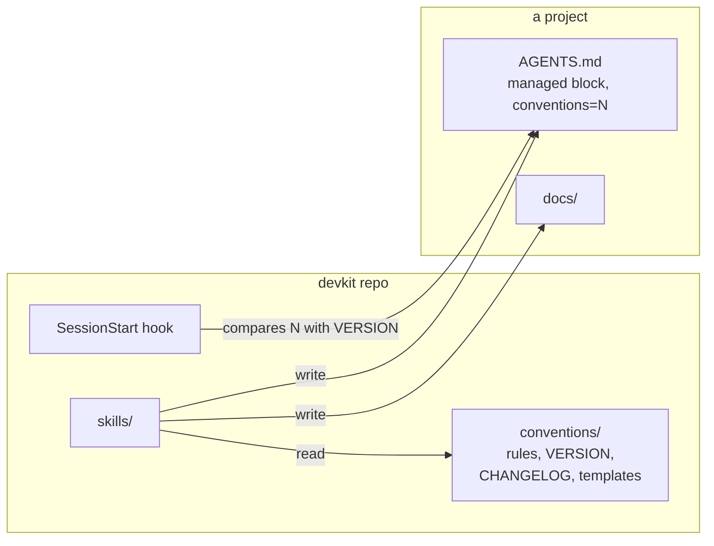
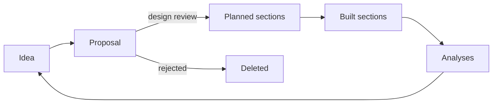

# devkit: Design

1. [Overview](#design-1r17)
2. [The document set](#design-80rq)
3. [Document lifecycles](#design-01c5)
4. [The product lifecycle](#design-e4be)
5. [Roles and team size](#design-460p)
6. [Agent context](#design-04hv)
7. [Products across repos](#design-gh6m)
8. [Section IDs](#design-bdk3)
9. [Plugin structure](#design-e8ng)
10. [Starting a project](#design-076f)
11. [The development workflow](#design-xn06)
12. [Typed commits](#design-6wkj)
13. [Versioning and upgrades](#design-b15a)
14. [Changing the conventions](#design-7z28)
15. [The doc linter](#design-0sxx)
16. [Distribution](#design-fx31)
17. [Testing](#design-axx8)
18. [Alternatives considered](#design-69gn)
19. [Open questions](#design-b2ea)

## 1. Overview <a id="design-1r17"></a><a id="D1"></a>

devkit is a Claude Code plugin kept in its own public git repo, which is also its marketplace. Users install it from GitHub and get updates when its version changes. The maintainer, and anyone working on a fork, installs it from a checkout instead, so the plugin loads in place and an edit reaches the next session in every project with no reinstall ([Distribution](#design-fx31)).

It has three parts:

- **Conventions**: one rules file, a version number, a changelog with a migration per version, and templates. They are the source of truth.
- **Skills**: one per task, from starting a project to closing a milestone. Each reads the conventions and templates when it runs rather than repeating them, so the rules exist in one place.
- **A SessionStart hook**: compares the version a project records with the current one and tells the agent when the project is behind.



*The skills read the conventions when they run and write the project's docs. The hook compares the version a project records with the current one.*

## 2. The document set <a id="design-80rq"></a><a id="D3"></a>

The conventions in [CONVENTIONS.md](../plugin/conventions/CONVENTIONS.md) codify what the existing projects already converged on, and settle the points where they differed, so each doc type has one template and one set of rules ([PRD: One format](prd.md#prd-830w)).

| Doc | Taken from | Settles |
| --- | --- | --- |
| `docs/prd.md` | fisc, mycraft and inbox PRDs | Requirements with IDs, so the design and plan can cite them |
| `docs/design.md` | fisc, omnix, anneal and kerfu designs, and the design-doc skill | One file, however long, since agents load one section by its ID ([One file per doc](#design-a05p)) |
| `docs/plan.md` | omnix's task IDs, grafos's shrinking plan | One plan, holding only the remaining work, in place of `todo.md` |
| `docs/ideas.md` | New | Unscheduled ideas, kept out of the plan so it shows only scheduled work |
| `docs/proposals/` | anneal, kerfu, grafos | Temporary, deleted once decided |
| `docs/analyses/` | anneal's spike results | Kept as evidence |
| `docs/user/` | mycraft and grafos | Indexed by a README table, organized by task |
| `docs/ux.md` | New | The designer's doc: flows, screens and interaction rules ([Roles and team size](#design-460p)) |
| `docs/plan/` | New | One file per milestone, so parallel work doesn't collide in one plan file ([Many people at once](#design-5ndn)) |
| `docs/ops/` | New | Runbooks for projects that run as a service. Optional. |

Analyses hold every kind of evidence: spikes, benchmarks, user research, incident reviews and outcome reviews. Stable IDs tie the docs and code together ([Section IDs](#design-bdk3)). The writing style comes from the user's global preferences, with stricter rules for text users read.

## 3. Document lifecycles <a id="design-01c5"></a><a id="D4"></a>

The key decision is which docs are permanent. Agents treat everything in the repo as current, so a finished proposal or a stale plan item misleads them. Docs therefore hold only the current state of the process, and git holds the history. The one exception is checking off plan tasks while a milestone is in progress. The current state includes what is decided but not built, marked as planned ([Planned sections](#design-5geq)).

- **Proposals** are arguments, deleted once decided. A design review writes the decided change into its final docs and deletes the proposal in the same change ([Design review](#design-vb0a)). Git keeps the original. This is grafos's rule. It replaces the per-project choices: anneal kept proposals, and omnix banned them.
- **Planned sections** carry a marker naming the milestone that builds them, and lose it when that milestone finishes.
- **The plan** shrinks. A finished milestone is removed. The plan stays short enough to read in full each session.
- **Analyses** are kept and never rewritten. They are the evidence the design cites.
- **Done means documented**, from mycraft: a milestone isn't done until the user docs, UX and design match what was built ([PRD: Docs current with the code](prd.md#prd-2c17)).

## 4. The product lifecycle <a id="design-e4be"></a><a id="D15"></a>

devkit treats product development as version control ([PRD: Lightweight change management in the repo](prd.md#prd-8z7e)). Main holds the reviewed state of the whole process, not only of the code: what is built, what is decided but not built, and what is being considered. Branches hold unreviewed work, and a pull request, or the user's approval on a solo project, is the filter. Git history holds how each part got there.

### 4.1 Stages <a id="design-x8cc"></a><a id="D15.1"></a>

| Stage | On main as | Skills |
| --- | --- | --- |
| Idea | A line in `docs/ideas.md` | `plan` |
| Under consideration | A proposal in `docs/proposals/` | `proposal` |
| Decided, not built | Sections in the PRD, UX and design in final form, marked planned | `design-review` |
| Being built | The same sections, cited by open plan tasks | `implement`, `fix-bug` |
| Built | The same sections without the marker, and `docs/user/` updated | `finish-milestone`, `user-docs`, `release` |
| Operated | Runbooks in `docs/ops/`, incident reviews in `docs/analyses/` | `analysis` |
| Learned | Research and outcome reviews in `docs/analyses/` | `analysis` |



*Each stage leaves a reviewed result on main, and what is learned starts the next change.*

### 4.2 Planned sections <a id="design-5geq"></a><a id="D15.2"></a>

A decided change is written straight into its final home. A section not built yet has a marker naming the milestone that builds it, `**Planned:** M5`, as the first line under its heading (CONVENTIONS section 3.6). A PRD requirement carries it after its anchor. Every heading and requirement inside a planned section carries its own marker, since a reader who follows a link to a subsection never sees its parent's. A partly built section keeps its current text and adds the change as a planned subsection. Overviews, diagrams and tables can't carry a marker, so they show only what is built, and a planned change to one goes in a planned subsection.

The marker is state, so tooling keeps it honest. The linter fails when a marker names a milestone the plan doesn't have, so removing a milestone can't leave planned sections behind, and when a heading or requirement inside a planned section has no marker. `fmt` adds "(planned)" to links and contents entries for a planned section, so a link from built text doesn't read as built. A marker doesn't say whether its milestone is still active, so `audit` asks about milestones with no commits in 90 days. `finish-milestone` removes the markers for its milestone and changes nothing else in the section. `implement` treats a planned section as a spec to build. Dropping planned work removes its sections, or moves them to Alternatives considered, in a reviewed change. `docs/user/` holds only built behavior.

### 4.3 Design review <a id="design-vb0a"></a><a id="D15.3"></a>

A proposal is an argument: the problem, the options and the case for one. It is optional, since a change that needs no argument skips it.

The decision is one reviewed change, made by `design-review`. It first takes each of the proposal's open questions to the user, with pros and cons and a recommendation, or as a spike when only evidence can settle it, so none is settled silently. A spike becomes a plan task ahead of the work that depends on it. It then writes the PRD, UX and design into their final wording with planned markers, writes new sections as headings that `just fmt` numbers and gives IDs, adds the plan tasks, moves rejected options into Alternatives considered, and deletes the proposal. Reviewers see the docs as they will read, as a diff against main, so approving and merging it is the decision. Nothing rewrites that text after approval except removing the marker when it ships.

Exploration before it can take any number of commits on a branch, and none of it reaches main. A proposal may be merged on its own when it is worth wider discussion. Building takes as many changes as the work needs, and a small feature can put the design review and the code in one change.

### 4.4 The ends of the lifecycle <a id="design-36s7"></a><a id="D15.4"></a>

A release is an annotated tag listing user-visible changes. `release` builds them from the commits' `Changelog:` trailers since the last tag ([Release notes](#design-fs7z)), checks that `docs/user/` covers them, and writes the tag. An incident review is an analysis of what happened, the cause and what changes. Each PRD success criterion says how it is measured, and an outcome review checks the criteria after a release. Its recommendations become ideas or proposals, which closes the loop.

## 5. Roles and team size <a id="design-460p"></a><a id="D16"></a>

### 5.1 A home for each role <a id="design-x79v"></a><a id="D16.1"></a>

| Role | Doc | IDs |
| --- | --- | --- |
| Product manager | `docs/prd.md` | `prd-` |
| Designer | `docs/ux.md` | `ux-` |
| Engineer | `docs/design.md`, `docs/plan.md` | `design-`, M |
| Researcher | `docs/analyses/` | None |
| Writer | `docs/user/` | None |
| Operator | `docs/ops/` | None |

`ux.md` describes how people experience the product: flows as Mermaid diagrams, screens as PNG or SVG images in `docs/ux/`, interaction rules, and the design system where there is one. Reviewers compare screens in the Git host's image diff. Each section's text says what its screens show, so an agent doesn't depend on the images. A section whose source lives in a design tool links to it, and the committed image is the decided version. A project starts `ux.md` when it first has an interface beyond commands. A threat model is an optional Security section in the design. `design.md` keeps its name, which is also the prefix of its IDs.

### 5.2 Solo and team <a id="design-gn7n"></a><a id="D16.2"></a>

The layout and lifecycle are the same at any size ([PRD: Any team size](prd.md#prd-77ak)). What scales is how much is written and who reviews.

| | Solo | Team |
| --- | --- | --- |
| Unreviewed work | The working tree, or a branch | A branch |
| Review | The user approves the agent's change | A pull request |
| Design review | One commit on main | One pull request |
| Proposals | Rare, for changes worth arguing | For changes others must agree on |
| Roles | One person, prompted per role | CODEOWNERS maps doc paths to people |

A project in team mode says so in `AGENTS.md`, outside the managed block, and the skills read it. Solo, `design-review` asks one question per role the change touches, so one person still covers each view. People who don't use git review and comment on pull requests in the browser, or pass feedback through an agent. A commit that resolves feedback says in its body what was raised and how it was resolved, so the outcome is in the repo even when the discussion isn't ([PRD: Feedback without git](prd.md#prd-kb8q)).

### 5.3 Many people at once <a id="design-5ndn"></a><a id="D16.3"></a>

Every design review touches shared files. Team mode requires branches to be current with main before merging, or a merge queue, so the linter checks the merged result. Random IDs don't race, and the rare clash fails as a duplicate. Git merges edits to different sections of one doc cleanly, a conflict in the generated numbers or contents goes away by running `just fmt` again, and the plan keeps one file per milestone in `docs/plan/`, so most text conflicts disappear ([One file per doc](#design-a05p)).

Two design reviews that change the same section are a design conflict. It surfaces when the later one rebases onto a main holding the earlier one's planned sections, and `design-review` re-checks its changes against what is new on main after every rebase. Duplicate effort is for people to coordinate. Who works on a task lives in its pull request or a tracker, never in the plan.

## 6. Agent context <a id="design-04hv"></a><a id="D17"></a>

Agents succeed or fail on context ([PRD: The repo is all an agent needs](prd.md#prd-5h1g)). The test for every rule here is whether an agent at any stage can find what it needs, trust that it is current, and load only that.

- **Finding it.** `AGENTS.md` points to `docs/README.md`, which indexes every doc with a line on what it holds. IDs lead to the exact section, read by grepping for its anchor, and milestone files keep each load small.
- **Trusting it.** A built section matches the code because a milestone isn't done until it does. A planned section says it isn't built.
- **History.** Commits cite IDs, so `git log --grep` on an ID returns every change to a section with its reasons ([PRD: Every change traces](prd.md#prd-x3qg)). The skills read it before changing a section.
- **By stage.** Each skill names what it reads: a build reads the task, the planned sections it cites, the built sections they depend on, and the code. A bug fix reads the user docs and design for the behavior, incident reviews and the cited sections' history.
- **Beyond the checkout.** Unreviewed work on other branches isn't context, and no skill depends on the Git host's CLI. Related repos are declared in `AGENTS.md` and cloned to read ([Products across repos](#design-gh6m)). Discussion elsewhere is out of reach by design, and its outcome lands in commits.

## 7. Products across repos <a id="design-gh6m"></a><a id="D18"></a>

A monorepo is the first choice. When components must live apart, a product repo holds the PRD, `ux.md`, the design of what crosses repos such as contracts between components, the cross-repo proposals and the outcome reviews. Each component repo keeps a design of its own internals and its own plan.

- A change that crosses repos has one design review, in the product repo. Component repos follow through implementation, with planned sections where their internals change.
- Each repo's `AGENTS.md` has a Related repos section, outside the managed block, naming each related repo by a short name with its role and clone location.
- Citations across repos are qualified, as in `api:design-7kq3`. The linter skips them, since it runs without the network, and `audit` checks them with the related repos cloned.
- A product milestone lists tasks per repo, as in `M7.2 (api)`. `finish-milestone` in the product repo removes planned markers only once the component changes it cites have merged.

## 8. Section IDs <a id="design-bdk3"></a><a id="D20"></a>

Readers find their way in a long doc by its numbers, while code, commits and other repos need a name for a section that never changes ([Numbered IDs](#design-27ev)). So each section of the PRD, `ux.md` and design gets a short random ID that never changes, and `just fmt` generates the numbers readers see ([PRD: Every change traces](prd.md#prd-x3qg), CONVENTIONS section 2).

### 8.1 The ID <a id="design-df0k"></a><a id="D20.1"></a>

An ID is the doc's name, a hyphen and four characters, such as `prd-4hz8`, `ux-c3pa` or `design-7kq3`.

- **The doc name** says what the ID points at to someone reading code who doesn't know devkit, and which file holds it, since each doc is one file ([One file per doc](#design-a05p)). Another repo's IDs are qualified the same way, as in `api:design-7kq3`.
- **One string** is the anchor, the link fragment, the code citation and the commit citation. It uses only letters, digits and a hyphen, so no comment syntax, shell, URL, YAML or chat tool treats it specially.
- **The characters** are lowercase Crockford base32, which leaves out `i`, `l`, `o` and `u` so none look alike. Each ID has a letter and a digit, so none implies an order or matches a word or year such as `design-time` or `ux-2025-redesign`, and the linter can check citations in code ([The doc linter](#design-0sxx)).
- **Four characters** give about 800,000 IDs per doc. `fmt` checks a new ID against every ID in the repo and its history, so none is reused, and only two branches adding sections at once can clash, which the linter catches on merge.

Plan milestones and tasks keep `M3` and `M3.2`, since the plan is ordered work that is deleted when done, and "M3" is easy to say. CONVENTIONS.md keeps its numbered sections, which are devkit's internals rather than a project doc.

### 8.2 Headings, links and citations <a id="design-bm50"></a><a id="D20.2"></a>

Each heading below a doc's title ends with an anchor holding its ID:

```markdown
### 3.2 Retries <a id="design-7kq3"></a>

**Planned:** M4

A failed sync retries with backoff, up to five attempts
([PRD: Edits reach every device](prd.md#prd-4hz8)). Edits wait in the
queue until the server confirms them (see [Queue](#design-b6tn)).
```

GitHub and VS Code don't show the anchor, so a reader sees numbered headings and references written as titles. A reference is a link to the ID whose text is the target's title, after the doc's name when the target is in another doc. Words such as "see" go outside the link.

Links show titles because a title changes only when someone renames the section, while a number changes whenever anything above it moves. So a reorder touches only one doc's headings and contents ([Other ways to show sections](#design-8wnn)). Numbers stay in headings, so a reader can find their way and say "see 3.2".

In the PRD, each area is a heading and each requirement a numbered item whose bold lead is its title, with its anchor after the title (CONVENTIONS section 2). Bulleted items aren't requirements, so bold-led bullets elsewhere get no IDs.

Code cites the bare ID, as in `// Give up after five attempts, design-7kq3.`, and commits cite IDs in a `Refs:` trailer, so subjects say what changed in words. `git grep design-7kq3` finds the code and docs about a section, and `git log --grep design-7kq3` its commits, wherever it has moved. Outside the repo, a full link is built from the ID, and a GitHub autolink per doc turns bare IDs in commits, pull requests and issues into that link. Analyses cite bare IDs too, since they are never rewritten and a link names a doc the section may later leave.

### 8.3 `just fmt` does the bookkeeping <a id="design-4kkx"></a><a id="D20.3"></a>

Nobody writes a number or a link's text by hand. `.devkit/fmt-docs.sh`, run by `just fmt`:

1. Numbers every heading in the PRD, `ux.md` and design in reading order, and every requirement within its area.
2. Gives a fresh ID to any heading or requirement that lacks one.
3. Turns each bare ID in a doc into a link, and rewrites every link's text to its target's title, with "(planned)" for a planned section, and its path to its target's doc.
4. Rewrites links and code citations that name an extra anchor to the section's main ID.
5. Rewrites the contents list as one link per chapter. The contents list is the first run of list items before the first heading where each item is a link or plain text and at least one is a link.

So adding a section is writing a plain heading, and a doc can cite a bare ID anywhere. An author may also write a new anchor by hand, so one edit can add sections that cite each other. `fmt` keeps a hand-written ID that has the right form and isn't in the repo or its history, and replaces it otherwise.

Minting needs the whole history, so in a shallow clone `fmt` refuses to mint. `--check` changes nothing. It reports what `fmt` would change and the citations it can't fix, and the linter runs it, so the two never disagree. `fmt` leaves analyses alone.

### 8.4 One file per doc <a id="design-a05p"></a><a id="D20.4"></a>

The PRD, `ux.md` and design are each one file, so an ID's doc name is its file and every link built from an ID keeps working however the doc is reorganized ([Docs split by chapter](#design-x9tv)). An agent loads a section by ID, with `grep -n 'id="design-7kq3"'` and a read to the next heading. Git merges edits to different sections of one file cleanly, and a conflict in the regenerated contents is resolved by running `fmt` again.

Past 600 lines the linter warns instead of failing, and the doc skills look for content that belongs elsewhere: evidence in an analysis, how-to in the user docs, or Alternatives considered trimmed. A design that keeps growing usually describes a system ready to split into components with their own repos ([Products across repos](#design-gh6m)). That is a design decision, not a file layout.

### 8.5 Restructuring <a id="design-p391"></a><a id="D20.5"></a>

Each move is an edit to the text followed by `just fmt`, and `restructure` does the work. CONVENTIONS section 18 lists the moves. Three choices shape them:

- **A merge keeps one ID** and holds the absorbed one as an extra anchor, so grepping the merged section's IDs finds both histories. A split keeps the original ID with the part that keeps the main meaning, and only a person can tell which part each citation meant.
- **A delete leaves no tombstone.** Citations still pointing at it fail the lint, and `git log --grep` still shows why the section existed.
- **A move to another doc takes that doc's ID**, so an ID always names the file that holds it. Links from outside the repo break on such a move, and bare IDs don't, which is why code, commits and analyses use them.

### 8.6 Moving existing projects <a id="design-1gse"></a><a id="D20.6"></a>

The v1 to v2 migration runs `fmt-docs.sh --adopt`. It joins a doc split by chapter back into one file, gives each section a new ID, keeps its old number as a second anchor, as in `<a id="design-7kq3"></a><a id="D4.2"></a>`, turns the PRD's `**R1.2**` items into numbered requirements, and turns citations in docs into links.

Citations in code must be rewritten too, since once the docs are reordered heading 4.2 may be a different section. `--adopt` can't tell a citation from an identifier such as `R2`, so it lists every match and `upgrade` rewrites the citations. Commits keep their old IDs, which are found by grepping for the anchor, `id="D4.2"`.

## 9. Plugin structure <a id="design-e8ng"></a><a id="D5"></a>

```
devkit/
  .claude-plugin/marketplace.json   the repo as a marketplace
  .github/workflows/check.yml       CI running just check
  plugin/
    .claude-plugin/plugin.json
    conventions/
      CONVENTIONS.md                the rules
      VERSION                       an integer
      CHANGELOG.md                  what changed per version, and its migration
      templates/                    AGENTS.md, agents-block.md, justfile, lint-docs.sh, docs/...
    skills/<name>/SKILL.md          invoked as devkit:<name>
    hooks/hooks.json
    scripts/session-start.sh
  tests/
```

The skills are:

| Skill | Purpose |
| --- | --- |
| `new-project` | Start a project and draft its PRD ([Starting a project](#design-076f)) |
| `prd`, `design`, `plan`, `proposal`, `analysis`, `user-docs` | Write and update one doc type each |
| `ux`, `release` | Write the UX doc, and tag a release ([Roles and team size](#design-460p), [The ends of the lifecycle](#design-36s7)) |
| `design-review` | Write a decided change into the docs as planned sections, or reject a proposal ([Design review](#design-vb0a)) |
| `finish-milestone` | Check docs match a milestone, then remove it from the plan |
| `implement`, `fix-bug` | Build a task, and fix a bug from a failing test ([The development workflow](#design-xn06)) |
| `upgrade` | Apply the migrations since a project's version ([Being told, and upgrading](#design-8vtq)) |
| `audit` | Find a project's drift from the current rules ([Finding drift](#design-njs0)) |
| `restructure` | Merge, split, move or reorder sections, keeping every ID ([Restructuring](#design-p391)) |

Each skill names its template and the conventions by `${CLAUDE_PLUGIN_ROOT}` paths and reads them when it runs. A skill's description says when to use it, so plain requests such as "write a proposal for switching to SQLite" find the right one. Every description except those of `new-project` and `upgrade` starts with "In a project that uses devkit", so the skills aren't offered in projects that don't ([PRD: Quiet outside devkit projects](prd.md#prd-4svd)).

The doc skills check for the managed block in `AGENTS.md` first. In a project without it, they say the project doesn't use devkit and ask before applying its structure ([PRD: Quiet outside devkit projects](prd.md#prd-4svd)).

### 9.1 What the plugin ships <a id="design-0qqy"></a><a id="D5.1"></a>

Every skill the plugin ships produces, updates or depends on a lifecycle doc ([PRD: Only the lifecycle](prd.md#prd-a6kk)). Each one costs context in every session of every project and a chance of triggering on an unrelated request, so a skill that doesn't touch the docs doesn't ship. There is no skill for refactoring code ([Shared rules](#design-0brx)) and none for a view across projects, since the hook tells each project when it is behind ([Being told, and upgrading](#design-8vtq)). `evolve` changes devkit itself, so it lives in devkit's repo ([Where evolve lives](#design-79rj)).

## 10. Starting a project <a id="design-076f"></a><a id="D6"></a>

`devkit:new-project` turns one request into a committed repo ([PRD: Start a project in one request](prd.md#prd-gfx8)):

1. Work out the name, pitch, location, stack and any source idea from the request, and ask once for what's missing. Unless the request names a location, the question asks for one, suggesting `<parent of the current repo>/<slug>` when the current directory is in a git repo. There is no setting for it, since where a user keeps code is outside the lifecycle ([PRD: Only the lifecycle](prd.md#prd-a6kk)).
2. Create the repo with `AGENTS.md`, `CLAUDE.md` containing `@AGENTS.md`, `README.md`, a justfile, `docs/README.md` and `docs/prd.md`. If the stack is known, add a first component with its own justfile as a module.
3. If the user points to an idea doc, start from it, and follow any graduation steps its repo's `AGENTS.md` gives, so the two flows join.
4. Draft the PRD with `devkit:prd`, leaving unknowns as open questions.
5. Commit, and tell the user what the PRD needs from them.

It deliberately stops at the PRD. The PRD is the one doc where the user's intent can't be inferred, so it is the natural checkpoint before the design.

## 11. The development workflow <a id="design-xn06"></a><a id="D12"></a>

The conventions cover how code is written and shipped as well as how docs are kept, so an agent works the same way in every project ([PRD: One way of working](prd.md#prd-27en)). The rules are about process, not technology: no rule names a language, library or domain. They live in CONVENTIONS.md sections 9, 11, 12, 13 and 16, and the managed block carries a line for each.

### 11.1 Skills for the core loop <a id="design-rw31"></a><a id="D12.1"></a>

- `implement` takes a plan task from reading its cited sections to a commit that ticks it. It starts and ends with `just check` passing, and stops to ask where the design is silent, so design decisions don't get made inside code.
- `fix-bug` reproduces first, writes a failing test, then decides whether the fault is in the code, the design or the PRD. A bug the design caused is fixed in the design too, so the next agent doesn't repeat it.

### 11.2 Shared rules <a id="design-0brx"></a><a id="D12.2"></a><a id="design-n7b4"></a><a id="D12.4"></a>

- **Commits** are one change with its tests and docs, with a plain subject and trailers citing IDs and naming its kind of change ([PRD: Docs current with the code](prd.md#prd-2c17), [Typed commits](#design-6wkj)). Commits are the history the docs leave out, so they carry the why.
- **Releases** are annotated tags whose messages list user-visible changes. A CHANGELOG file would be history in the docs, which the lifecycles rule out ([Document lifecycles](#design-01c5)).
- **Tests** run offline from `just test`, and a bug fix starts with a failing test.
- **Dependencies** that shape the design are design decisions, recorded with their alternatives.
- **Secrets** stay out of git, with local settings in a gitignored `.env` documented by `.env.example`.
- **Refactors** keep behavior, so their only effect on the docs is keeping them true. ID citations move with their code, and design sections describing the old structure are updated (CONVENTIONS section 16). One that changes a design section starts as a proposal. The managed block carries a line for it, so agents without the plugin follow it. Judging an abstraction is coding craft, not a doc rule, so there is no refactor skill ([What the plugin ships](#design-0qqy)).
- **Recipes** gain `fmt`, `run` and `setup` where they apply, so the same command does the same job everywhere.

### 11.3 Finding drift <a id="design-njs0"></a><a id="D12.3"></a>

Migrations only cover what changed between versions. A project can also drift on its own, such as a hand-edited managed block or a `todo.md` that crept back in. `audit` compares a project with the current rules, running the doc linter for what is mechanical and reading the rest ([PRD: Drift is visible](prd.md#prd-5j7p)).

## 12. Typed commits <a id="design-6wkj"></a><a id="D19"></a>

IDs say what part of the product a commit touches, not what kind of change it is. Typed commits add the kind, so readers filter history and `release` stops judging each commit by its subject ([PRD: History by kind of change](prd.md#prd-6v2e)).

### 12.1 The trailers <a id="design-rpd8"></a><a id="D19.1"></a>

Every commit ends with a `Change:` trailer. A commit users notice also has a `Changelog:` trailer, one sentence written for users under section 4.1 of the conventions. A `Refs:` trailer cites the IDs the commit touches, so the subject says what changed in words ([Other places to cite IDs](#design-8b7e)).

CONVENTIONS section 17 gives the nine values and which need a `Changelog:` line. The six user-facing ones are Keep a Changelog's categories and GitLab's trailer values, so notes group the way most changelogs do and tools such as git-cliff can read them. `ops`, `docs` and `internal` serve the other readers in [A home for each role](#design-x79v). A change that is two kinds is two commits.

Trailers keep the data in the repo, where git reads it with no host access ([Agent context](#design-04hv)):

```sh
git log --grep '^Change: fixed' v1.2.0..
git log --format='%(trailers:key=Changelog,valueonly)' v1.2.0..
```

They don't show in `--oneline`, and each commit gains two lines. Agents write nearly every commit, so the lines cost little. On a squash merge in team mode, the squash message must keep the trailers, and the commit check catches it when it doesn't.

### 12.2 The commit check <a id="design-ba7b"></a><a id="D19.2"></a>

`.devkit/check-commits.sh` fails on a commit with no `Change:`, more than one, an unknown value, a user-facing value with no `Changelog:`, or a `Changelog:` on `docs` or `internal`. It takes a git range, and defaults to the commits not yet on the upstream branch, so `just lint` checks unpushed work and CI can pass the range it builds. Merge commits are skipped. So are commits made before the script was added, so a project's history from before it adopted devkit needs no rewriting. Like the linter, it is plain bash with only git, and devkit replaces it on upgrade ([The doc linter](#design-0sxx)).

### 12.3 Release notes <a id="design-fs7z"></a><a id="D19.3"></a>

`release` builds the tag message from the `Changelog:` trailers since the last tag, grouped under the `Change:` values in table order, with `ops` notes in a section for operators. It then checks the notes against `docs/user/`. For commits from before a project added the commit check, it reads the log and judges.

## 13. Versioning and upgrades <a id="design-b15a"></a><a id="D7"></a>

### 13.1 Versions <a id="design-y9b7"></a><a id="D7.1"></a>

The conventions have an integer version in `plugin/conventions/VERSION`, separate from the plugin's version. It changes only when what a project should look like changes, not when a skill's wording improves. Each version has a section in `CHANGELOG.md` headed `## v<N>: <summary>`, with what changed and a migration: steps for an agent to bring a project from N-1 to N.

Migrations are written for an agent, not a script. Most real changes, such as merging a todo file into the plan or folding a done proposal into the design, need judgment that a script can't make.

### 13.2 Where a project records its version <a id="design-m7en"></a><a id="D7.2"></a>

The project's `AGENTS.md` contains a block managed by devkit, from `<!-- devkit:begin conventions=1 -->` to `<!-- devkit:end -->`, summarizing the conventions. The marker records the version, and the block gives the conventions to any agent that reads `AGENTS.md`, plugin or not ([PRD: Agents know the rules without the plugin](prd.md#prd-68zv)). Only an upgrade replaces the block, and everything outside it belongs to the project. One marker in a file the project already has avoids a separate stamp file.

### 13.3 Being told, and upgrading <a id="design-8vtq"></a><a id="D7.3"></a>

At session start, the hook reads the marker and `VERSION`. If the project is behind, it prints the changelog summaries since the project's version and asks the agent to offer `devkit:upgrade`. If the project is current or has no marker, it prints nothing, so it costs nothing in projects that don't use devkit.

`devkit:upgrade` collects the migrations, shows the user the concrete changes and questions, and applies them only after approval ([PRD: Existing projects catch up on request](prd.md#prd-a19r)). Then it replaces the managed block and commits. A migration that only replaces the block may proceed without asking.

### 13.4 Adopting devkit in an existing project <a id="design-3g74"></a><a id="D7.4"></a>

An existing project is at v0. The v1 migration is the adoption: inventory the docs, map them onto the document set, list where the project differs on purpose, and propose all of it before changing anything. Project rules that conflict with the conventions, such as omnix's ban on proposals, are the user's call: they stay as project rules outside the block or give way.

### 13.5 One version at a time <a id="design-w6fv"></a>

devkit's skills follow one version of the conventions, the plugin's own ([PRD: One version at a time](prd.md#prd-4e1x)). A skill run in a project on another version would write docs in the wrong form, so every skill that writes to a project compares the `AGENTS.md` marker with `VERSION` before it changes a file. Reading and critiquing a doc still work.

- **The project is behind.** The skill stops, names both versions and offers `devkit:upgrade`. On a team, whoever has the newer plugin opens the upgrade pull request, and `upgrade` commits on a branch in team mode.
- **The plugin is behind.** The skill stops and says to update the plugin.
- **No check.** `upgrade` exists to close the gap and `new-project` starts at the current version, so neither checks. `audit` already upgrades first.

The hook's messages for a project behind or ahead of the plugin say which side to update, and that the skills won't change files until then. The check is a line in each skill, and the consistency test fails when a skill that writes to a project lacks it.

Each skill has one version. A person with repos on different versions sees, in each one, which side to update.

## 14. Changing the conventions <a id="design-7z28"></a><a id="D8"></a>

Conventions will change as projects find better ways. The `evolve` skill makes the change in one place, in a session in the devkit repo ([PRD: Conventions evolve in one place](prd.md#prd-by6e), [Where evolve lives](#design-79rj)):

1. Decide whether it is a convention change, which needs a version and a migration, or a skill change, which doesn't.
2. Edit the rules, templates and skills together so they agree.
3. Bump `VERSION` and write the changelog section and migration, and bump the plugin version ([Versions](#design-chm4)).
4. Run `just check` and commit.

The change reaches new projects at once. Existing projects learn of it at their next session through the hook, and upgrade when the user chooses. A change usually comes up in the middle of project work: "from now on, plans should also have X". The skill separates what is general from what belongs to that project alone.

### 14.1 Where evolve lives <a id="design-79rj"></a><a id="D8.1"></a>

`evolve` is a skill in devkit's repo, in `.claude/skills/evolve/`, not in the plugin ([What the plugin ships](#design-0qqy)). It is offered only in a session in a devkit checkout or a fork, which is the only place it can edit. A fork carries it because it is part of the repo. A change that comes up in the middle of other project work is made by opening a session in the checkout. A rule that only matters to one project goes in that project's `AGENTS.md`, outside the managed block, which needs no skill.

## 15. The doc linter <a id="design-0sxx"></a><a id="D13"></a>

`lint-docs.sh` and `fmt-docs.sh` are plain bash scripts, compatible with the bash 3.2 that ships with macOS, using only POSIX awk and git. The linter checks the docs for em dashes, broken relative links, docs missing from their index, planned markers naming a milestone the plan doesn't have, planned markers in user docs, and headings and requirements inside a planned section without their own marker, and warns about docs past 600 lines ([One file per doc](#design-a05p)). A link to an anchor in a Markdown file, its own or another, must name an HTML `id` or `name` in that file or the slug GitHub gives one of its headings. Slugs are checked because heading links written before section IDs break silently when fmt renumbers a heading. Links to section IDs in the docs fmt rewrites are left to `fmt-docs.sh --check`, so each problem is reported once. M citations aren't checked, since finished milestones leave the plan.

It runs `fmt-docs.sh --check` and fails on what it reports: anything `fmt` would change, a link or citation naming an ID that doesn't exist, and an ID defined twice ([`just fmt` does the bookkeeping](#design-4kkx)). The two never disagree, since one script does both. IDs in Markdown backticks are examples and aren't checked, and neither are qualified IDs such as `api:design-7kq3`, which name another repo ([Products across repos](#design-gh6m)). Analyses aren't checked, since they are never rewritten.

Citations in code are checked too, since an ID such as `design-7kq3` can't be mistaken for anything else ([The ID](#design-df0k)). Code is every text file git tracks outside `docs/`, except files given the `devkit-examples` attribute in `.gitattributes`, so test fixtures, vendored code and docs about the conventions can hold example IDs. Old IDs such as `R2` are left alone in code, since they could be anything.

Each project gets copies at `.devkit/lint-docs.sh` and `.devkit/fmt-docs.sh`, run by its root `lint` and `fmt` recipes. A project's justfile can't reach the plugin's install path, and CI runs without the plugin, so the scripts must live in the repo. Like the managed block, the copies belong to devkit and are replaced on every upgrade, so a change to them is a convention change with a version bump. devkit itself runs them from `plugin/conventions/templates/`, so it has no `.devkit/`.

## 16. Distribution <a id="design-fx31"></a><a id="D14"></a>

devkit is a public GitHub repo that is its own marketplace ([PRD: Anyone can install it](prd.md#prd-25zb)).

### 16.1 Versions <a id="design-chm4"></a><a id="D14.1"></a><a id="design-h6r6"></a><a id="D14.4"></a>

The plugin version in `plugin.json` is semver whose major number is the conventions `VERSION`. A convention change bumps the major, a skill change the minor, and a fix the patch. Claude Code updates a cached install only when this version changes, so every change that should reach users moves it. With a separate plugin version, a convention change could ship without a bump and cached installs would miss it, so the consistency test fails when the major and `VERSION` disagree. Each release is an annotated `v<version>` tag.

### 16.2 Two ways to install <a id="design-er6e"></a><a id="D14.2"></a>

- **From GitHub**: `/plugin marketplace add jthacker/devkit`, then `/plugin install devkit@devkit`. Claude Code caches the plugin and updates it when the version changes. This is the route for users.
- **From a checkout**: `just install`. The plugin loads in place, so an edit reaches the next session. This is the route for the maintainer and for forks.

The README gives the GitHub route. Working from a checkout is in `AGENTS.md` and the user docs on forking.

### 16.3 Forks <a id="design-3ycr"></a><a id="D14.3"></a>

Someone who wants different conventions forks devkit, clones the fork and runs `just install` from it. A session in the fork offers `evolve`, which edits it ([Where evolve lives](#design-79rj)). Changes worth sharing go upstream as pull requests. Forks merging upstream changes is not supported ([Open questions](#design-b2ea)).

## 17. Testing <a id="design-axx8"></a><a id="D9"></a>

`just check` runs:

- shellcheck on the scripts,
- `claude plugin validate` on the marketplace and the plugin,
- the hook's tests, which run it against a fake plugin and fake projects that are current, behind, ahead, unmarked or without `AGENTS.md`,
- the doc linter on devkit's own docs, and its tests and those of `fmt-docs.sh` against fake projects, including adopting v1 docs,
- the commit check on unpushed commits, and its tests against a temporary repo,
- consistency checks: `VERSION` matches the newest changelog entry and the major number of the plugin version, every skill's name matches its directory and appears in the user docs, every path and skill a skill names exists, the managed block has its markers, and no em dashes.

CI runs `just check` on every push and pull request, and the commit check on every commit since the check was added. `mise.toml` pins `just` and `shellcheck`, and CI installs a pinned `claude` CLI, which validates manifests without credentials.

The skills are prompts, so the real test is using them, which the plan's trial milestones do.

## 18. Alternatives considered <a id="design-69gn"></a><a id="D10"></a>

### 18.1 A Copier or cookiecutter template <a id="design-x0cj"></a><a id="D10.1"></a>

Copier renders a project and merges template updates into it. But the projects span Rust, Swift, TypeScript and Python, so the shared part is conventions and judgment rather than files, and a three-way text merge can't fold a todo file into a plan. Skills can.

### 18.2 Architecture decision records <a id="design-8v7g"></a><a id="D10.2"></a>

A `docs/decisions/` folder with one file per decision. Each design section already records its decision and why, and Alternatives considered records what was rejected, without another folder to keep in step.

### 18.3 Other places for the conventions <a id="design-p18s"></a><a id="D10.3"></a><a id="design-g12q"></a><a id="D10.4"></a><a id="design-q7xy"></a><a id="D10.6"></a>

- **The global CLAUDE.md.** It loads in every session, including unrelated ones, has no version to fall behind, and other agents don't read it.
- **A full copy in each project.** Copies drift. The managed block is a short summary that an upgrade replaces wholesale.
- **A stamp file for the version.** The managed block must exist anyway, so its marker carries the version with no extra file.

### 18.4 Automatic upgrades <a id="design-at9m"></a><a id="D10.5"></a>

The hook could run the upgrade itself. But migrations rewrite docs, possibly in the middle of other work, so the user starts them.

### 18.5 A local marketplace only <a id="design-fz0q"></a><a id="D10.7"></a>

Everyone could install from a checkout. But that needs `just` and a checkout kept current by hand, and users would get every unreleased commit.

### 18.6 A decision log and Done list in the plan <a id="design-v77h"></a><a id="D10.8"></a>

Both are history, which git keeps with the commit that made each change. In the docs they grow without bound and cost context every session.

### 18.7 markdownlint and a link checker <a id="design-9gbv"></a><a id="D10.9"></a>

They add a tool dependency to every project, and none know devkit's rules, such as citations or the doc index.

### 18.8 Other ways to hold decided work <a id="design-19nh"></a><a id="D10.10"></a><a id="design-aq8m"></a><a id="D10.11"></a><a id="design-hj99"></a><a id="D10.12"></a>

- **Fold proposals in at acceptance.** The old rule. Main mixed built and unbuilt work with no marker, and reviewers read a proposal's prose, not the text that landed.
- **Accepted proposals as in-flight specs.** The review is still of prose, and the fold after shipping rewrites the design with no real review.
- **A feature branch per feature.** In-flight work is invisible from main, long branches drift, and dependent features need stacked branches.

### 18.9 Separate solo and team profiles <a id="design-s789"></a><a id="D10.13"></a>

A solo project that gains a contributor would need a migration between them, and the two would drift apart.

### 18.10 Syncing with a wiki <a id="design-pwq5"></a><a id="D10.14"></a>

Two places a doc can change means neither is the source of truth, and merging prose edits needs judgment a sync can't make. A one-way mirror people can comment on is in the ideas file.

### 18.11 One docs folder per role <a id="design-nm5p"></a><a id="D10.15"></a>

`docs/product/`, `docs/design/` and `docs/engineering/` would move every existing doc, and a solo developer would hop between folders for one change.

### 18.12 UX inside the PRD or the design <a id="design-xt88"></a><a id="D10.16"></a>

The PRD says what and why, not how screens behave, and the design is already the longest doc. The IDs also wouldn't say which kind of decision is cited.

### 18.13 A home repo per cross-repo change <a id="design-jgx4"></a><a id="D10.17"></a>

Nothing would hold product-level truth, and an agent in one component would have no fixed place to find the rest.

### 18.14 Numbered IDs <a id="design-27ev"></a><a id="D10.18"></a>

v1 took each ID from its heading number, as in `D4.2`. But a number can't both show where a section sits and name it forever, so restructuring a doc changed what citations meant, and two branches adding a section raced for the next number.

### 18.15 Open pull requests as agent context <a id="design-fp55"></a><a id="D10.19"></a>

Unreviewed work isn't part of the state of the process, reading it needs the Git host's CLI and credentials, and overlaps surface anyway on rebase ([Many people at once](#design-5ndn)).

### 18.16 Other skill boundaries <a id="design-p76p"></a><a id="D10.20"></a><a id="design-cfz1"></a><a id="D10.21"></a><a id="design-34r1"></a><a id="D10.22"></a>

- **Fold release into finish-milestone.** A release can ship part of a milestone or several, and outcome reviews would lose the event that prompts them.
- **Evolve in the plugin.** Every user would carry a skill that only edits in a checkout of devkit or a fork.
- **A short refactor skill.** It would trigger on every "clean up" request, for rules the managed block carries in one line.

### 18.17 The company as a project <a id="design-z0aj"></a><a id="D10.23"></a>

A company monorepo could hold many products as scopes under company objectives. That adds rules every solo project's agents read and skip, and there was no company repo to trial them on.

### 18.18 Issues in the repo <a id="design-g7pk"></a><a id="D10.24"></a>

devkit covers the docs that shape the product, not the queue of incoming work. Ideas go in `docs/ideas.md`, and a bug goes straight to `fix-bug`.

### 18.19 Other ways to type commits <a id="design-f5fy"></a><a id="D10.25"></a><a id="design-vn3e"></a><a id="D10.26"></a><a id="design-jfx8"></a><a id="D10.27"></a><a id="design-p4z3"></a><a id="D10.28"></a>

- **Conventional Commits.** The `fix(sync):` prefix spends subject characters, its types describe engineering work rather than who cares, and notes generated from it are subjects written for engineers.
- **One Changelog trailer only.** Untyped commits can't be told apart, and a forgotten trailer looks like an internal change.
- **Pull request labels or a release-note block.** They live on the Git host, so an agent needs its CLI to read them, and a solo project has no pull requests.
- **News fragments.** towncrier or Changesets add a folder that fills and empties each release, a tool per ecosystem, and a file that repeats the commit.

### 18.20 Other ways to restructure <a id="design-my4r"></a><a id="D10.29"></a><a id="design-3xt3"></a><a id="D10.30"></a><a id="design-x4ne"></a><a id="D10.31"></a><a id="design-zca3"></a><a id="D10.36"></a>

- **Renumbering with citations rewritten.** Commit messages and other repos can't be rewritten, so `git log --grep` and qualified IDs would point at the wrong section.
- **A list of retired IDs.** An extra anchor next to the text it names needs no lookup and moves with its section.
- **Fixed numbers that run out of order.** A restructured doc shows chapters such as 4, 15, 16, 5, which help nobody and look like mistakes.
- **Keeping every deleted ID.** Random IDs are checked against history, so the rule would only force anchors onto sections they don't belong to, and citations of a deleted section fail anyway.

### 18.21 Other ID forms <a id="design-6yvs"></a><a id="D10.33"></a><a id="design-ds24"></a><a id="D10.34"></a><a id="design-y17j"></a><a id="D10.35"></a>

- **A kind letter**, as in `D-7kq3`, means nothing in code to someone who doesn't know devkit, and matches too much to check code reliably.
- **A link style**, as in `design#7kq3`, uses `#`, which means something to chat tools, issue trackers and Markdown.
- **A tool prefix**, as in `devkit:D-7kq3`, doesn't name the doc, and clashes with the `api:` qualifier for other repos.
- **Names**, such as `design-retry-backoff`, invite renaming when a section's scope drifts, get long in comments, and can collide.
- **Sequential IDs**, such as `design-47`, still look ordered, and two branches still race for the next one.

### 18.22 Other ways to show sections <a id="design-8wnn"></a><a id="D10.37"></a><a id="design-8qht"></a><a id="D10.38"></a><a id="design-cc1v"></a><a id="D10.32"></a>

- **No section numbers.** A long doc is hard to find one's way in without them, and "see 3.2" is how people talk.
- **Numbers as link text.** Every reorder would rewrite the text of every link to a moved section in every doc, so a design review that adds an early chapter would show hundreds of changed lines and conflict with every other open review.
- **Visible IDs in headings.** Every heading and reference would show a code that means nothing to a reader.

### 18.23 Other places to cite IDs <a id="design-8b7e"></a><a id="D10.39"></a><a id="design-937p"></a><a id="D10.40"></a>

- **Paths in code citations.** The path repeats the ID's doc name and goes stale when a section moves to another doc.
- **IDs in commit subjects.** A random ID is 11 characters, and two or three crowd out what changed.

### 18.24 Docs split by chapter <a id="design-x9tv"></a><a id="D10.41"></a>

v1 split a doc past 600 lines into chapter files. An ID then names a doc but not a file, so links from outside the repo need a search and break when a section moves between files. Reading by ID gives agents narrower context than a chapter file.

### 18.25 Other ways to run several versions <a id="design-35ck"></a>

- **Pin the plugin per project.** Claude Code registers a marketplace and its pinned ref once per user, so it has no documented way to load two versions of devkit for two repos.
- **A copy of the plugin in each repo.** It loads by relative path and stays fixed, but gives up updates from GitHub, and each repo's skills drift on their own.
- **Support every version until it is deprecated.** Every skill and template would branch by version, and every change to them would be tested against each one. Migrations exist to avoid that.

Skills check the version instead ([One version at a time](#design-w6fv)).

## 19. Open questions <a id="design-b2ea"></a><a id="D11"></a>

- **Product repo size.** A product split over two repos may not need a third. A component repo could act as the product repo.
- **Attribution.** Docs never name people, but feedback comes from people. Naming them in commit bodies may be enough.
- **Outcome timing.** Some success criteria take weeks to measure. The plan could carry a task for each outcome review.
- **Fork versions.** A fork that evolves bumps `VERSION` on its own, so merging upstream conflicts. For now forks stay forks.
- **Copying an ID from the rendered page.** GitHub shows no IDs, and its heading link copies a slug that changes with the number. A note in the agents block may be enough, or each heading could show a link to its ID.
- **Plan IDs.** Tasks are cited in commits, but `M2.3` in code can't be checked ([Other ID forms](#design-6yvs)).
